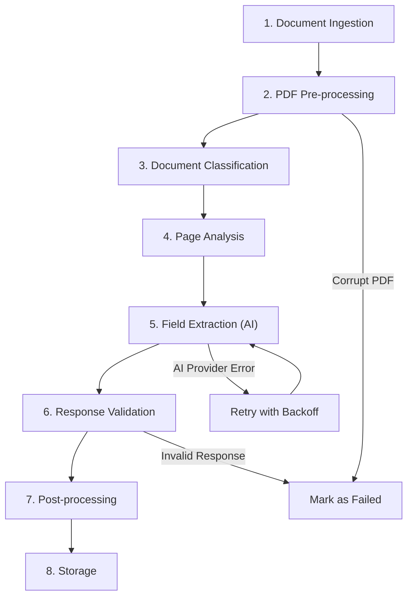

# SubGuard AI — AI Extraction Pipeline Design

> **Version:** 0.1.0 (Draft)  
> **Last Updated:** 2026-10-30  
> **Status:** Planning Phase

---

## 1. Overview

The AI extraction pipeline is responsible for converting unstructured PDF documents (Certificates of Insurance, endorsements) into structured, validated data that the compliance engine can evaluate.

### Boundary: What the Extraction Pipeline Does and Does NOT Do

| Does | Does NOT |
|---|---|
| Extract field values from documents | Decide whether values satisfy requirements |
| Identify document types | Determine compliance status |
| Report confidence and uncertainty | Invent values when information is missing |
| Return source text and page references | Make legal or contractual judgments |
| Flag ambiguous or contradictory information | Silently resolve contradictions |

**Core principle:** The extraction pipeline is a data extraction tool. The compliance engine (a separate, deterministic module) evaluates the extracted data.

---

## 2. Extraction Pipeline



### Stage 1: Document Ingestion

- Receive document ID and storage key from the job queue
- Verify the file exists in R2
- Verify the file hash matches the stored content_hash
- Download the file to a temporary location

### Stage 2: PDF Pre-processing (PyMuPDF)

- Open the PDF using PyMuPDF (`fitz`)
- Extract page count, page dimensions
- For each page:
  - Render to PNG image (300 DPI for AI input)
  - Extract text layer (if present)
  - Store page image in R2 under `{org_id}/documents/{doc_id}/pages/page_{n}.png`
  - Store text content in `document_pages` table

### Stage 3: Document Classification

- Examine the first page to determine document type
- **Heuristic checks first** (fast, free):
  - Look for "CERTIFICATE OF LIABILITY INSURANCE" or "ACORD 25" in text layer
  - Look for form-specific patterns (ACORD form identifiers)
- **AI classification if heuristics are inconclusive:**
  - Send first page image to AI with a classification prompt
  - Output: `document_type` with `confidence`
- Supported types: `coi`, `endorsement`, `policy_dec_page`, `other`, `unknown`

### Stage 4: Page Analysis

- For COIs (ACORD 25): Page 1 typically contains all certificate data; identify if multi-page
- For endorsements: Each page may be a separate endorsement; identify endorsement types
- Output: List of page groups to process (which pages to send to AI together)

### Stage 5: Field Extraction (AI Call)

- Send relevant page image(s) to the AI provider with a structured extraction prompt
- Request structured JSON output matching our Pydantic schema
- Include prompt version identifier for tracking

### Stage 6: Response Validation

- Parse the AI response as JSON
- Validate against the Pydantic schema (`ExtractionResult`)
- If validation fails: log the raw response, mark extraction as failed, allow retry
- If validation passes: proceed to post-processing

### Stage 7: Post-processing

- Normalize extracted values:
  - Currency: "$1,000,000" → 100000000 (cents)
  - Dates: Various formats → `YYYY-MM-DD`
  - Names: Trim whitespace, normalize casing
- Cross-reference: If the same field appears from multiple pages, record all instances
- Detect contradictions: Same field with different values → flag as uncertain

### Stage 8: Storage

- Create `extracted_fields` records with all evidence metadata
- Update `extraction_jobs` status to `completed`
- Update `documents` status to `processed`
- Enqueue compliance evaluation job

---

## 3. Structured Output Schema

### 3.1 Core Extraction Result

```python
class ExtractionResult(BaseModel):
    """Top-level extraction result from a document."""
    document_type: DocumentType
    document_type_confidence: float = Field(ge=0.0, le=1.0)

    # Entities
    certificate_holder: EntityInfo | None = None
    named_insured: EntityInfo | None = None
    producer: EntityInfo | None = None

    # Coverage sections
    coverages: list[CoverageExtraction] = []

    # Endorsement information
    endorsements: list[EndorsementExtraction] = []

    # Additional insured information
    additional_insureds: list[AdditionalInsuredExtraction] = []

    # Metadata
    metadata: ExtractionMetadata


class DocumentType(str, Enum):
    COI = "coi"                        # Certificate of Insurance (ACORD 25)
    ENDORSEMENT = "endorsement"        # Insurance endorsement
    POLICY_DEC_PAGE = "policy_dec_page" # Policy declaration page
    OTHER = "other"
    UNKNOWN = "unknown"
```

### 3.2 Entity Information

```python
class EntityInfo(BaseModel):
    """An entity mentioned in the document (insured, holder, producer)."""
    name: str | None = None
    address: str | None = None
    source_text: str               # Verbatim text from document
    page_number: int               # 1-indexed
    bounding_box: BoundingBox | None = None
    extraction_status: ExtractionStatus

class BoundingBox(BaseModel):
    """Normalized coordinates (0.0 to 1.0) relative to page dimensions."""
    x: float = Field(ge=0.0, le=1.0)       # Left edge
    y: float = Field(ge=0.0, le=1.0)       # Top edge
    width: float = Field(ge=0.0, le=1.0)   # Width
    height: float = Field(ge=0.0, le=1.0)  # Height
```

### 3.3 Coverage Extraction

```python
class CoverageType(str, Enum):
    GENERAL_LIABILITY = "general_liability"
    AUTO_LIABILITY = "auto_liability"
    WORKERS_COMP = "workers_comp"
    UMBRELLA_EXCESS = "umbrella_excess"
    PROFESSIONAL_LIABILITY = "professional_liability"
    OTHER = "other"

class MoneyValue(BaseModel):
    """A monetary value extracted from a document."""
    amount_cents: int              # Value in cents ($1,000,000 = 100_000_000)
    raw_text: str                  # Original text, e.g., "$1,000,000"
    confidence: float = Field(ge=0.0, le=1.0)

class DateValue(BaseModel):
    """A date extracted from a document."""
    date: date                     # Parsed date
    raw_text: str                  # Original text, e.g., "01/15/2025"
    confidence: float = Field(ge=0.0, le=1.0)

class CoverageExtraction(BaseModel):
    """Extracted coverage information for one coverage type."""
    coverage_type: CoverageType
    policy_number: str | None = None
    insurer_name: str | None = None

    # Limits (all nullable — not every coverage type has all fields)
    each_occurrence: MoneyValue | None = None
    general_aggregate: MoneyValue | None = None
    products_completed_ops: MoneyValue | None = None
    personal_adv_injury: MoneyValue | None = None
    combined_single_limit: MoneyValue | None = None      # Auto
    per_accident: MoneyValue | None = None                # WC
    disease_each_employee: MoneyValue | None = None       # WC
    disease_policy_limit: MoneyValue | None = None        # WC

    # Dates
    effective_date: DateValue | None = None
    expiration_date: DateValue | None = None

    # Evidence
    source_text: str
    page_number: int
    bounding_box: BoundingBox | None = None
    extraction_status: ExtractionStatus
```

### 3.4 Endorsement Extraction

```python
class EndorsementType(str, Enum):
    ADDITIONAL_INSURED = "additional_insured"
    WAIVER_OF_SUBROGATION = "waiver_of_subrogation"
    PRIMARY_NONCONTRIBUTORY = "primary_noncontributory"
    OTHER = "other"

class EndorsementExtraction(BaseModel):
    """Extracted endorsement information."""
    endorsement_type: EndorsementType
    description: str | None = None
    endorsement_number: str | None = None
    applicable_policy: str | None = None        # Which policy this endorsement applies to
    named_entities: list[str] = []               # Entities named in the endorsement
    key_terms: list[str] = []                    # Important terms/phrases
    source_text: str                             # Verbatim text
    page_number: int
    bounding_box: BoundingBox | None = None
    extraction_status: ExtractionStatus

class AdditionalInsuredExtraction(BaseModel):
    """Specific additional insured entity found in documents."""
    entity_name: str
    source_document_type: str                    # "endorsement" or "coi"
    endorsement_reference: str | None = None     # Form number if available
    blanket_or_scheduled: str | None = None      # "blanket", "scheduled", or None
    source_text: str
    page_number: int
    extraction_status: ExtractionStatus
```

### 3.5 Extraction Status and Metadata

```python
class ExtractionStatus(str, Enum):
    EXTRACTED = "extracted"         # Value was found and extracted
    NOT_FOUND = "not_found"         # Expected field was not present
    UNCERTAIN = "uncertain"         # Value found but confidence is low
    PARTIAL = "partial"             # Only part of expected data found
    ERROR = "error"                 # Error during extraction of this field

class ExtractionMetadata(BaseModel):
    """Metadata about the extraction process itself."""
    provider: str                   # "google", "openai", etc.
    model: str                      # "gemini-2.0-flash", etc.
    prompt_version: str             # "v1.0", "v1.1", etc.
    processing_time_ms: int
    input_tokens: int | None = None
    output_tokens: int | None = None
    total_pages_processed: int
    extraction_timestamp: datetime
```

---

## 4. Evidence Representation

### Why Evidence Traceability Is Critical

SubGuard AI's credibility depends on users being able to verify every AI extraction against the original document. Without evidence traceability:

- Users cannot trust the system's findings
- There is no way to identify extraction errors
- Compliance decisions become unauditable
- The product provides no advantage over simply reading the PDF

### Evidence Chain

Every extracted value carries:

1. **Source document ID** — Which document this came from
2. **Page number** — Which page (1-indexed)
3. **Source text** — The exact verbatim text from the document that supports this value
4. **Bounding box** — Normalized coordinates (0-1) for highlighting the region in the PDF viewer
5. **Confidence score** — The AI model's confidence in the extraction (0.0 to 1.0)
6. **Extraction status** — Whether the extraction was successful, uncertain, or failed

### Evidence in the UI

When a user views a compliance finding:
1. They see the finding (e.g., "GL each occurrence: \$1,000,000")
2. They can click an "Evidence" link
3. The PDF viewer opens to the relevant page
4. A highlight box is drawn over the region identified by the bounding box
5. The source text is shown alongside

---

## 5. AI Provider Abstraction

### 5.1 Provider Interface

```python
from abc import ABC, abstractmethod
from typing import Type

class ExtractionProvider(ABC):
    """Abstract base class for AI extraction providers."""

    @abstractmethod
    async def extract_from_pages(
        self,
        pages: list[PageImage],
        prompt: str,
        response_schema: Type[BaseModel],
    ) -> ProviderResponse:
        """Send page images to AI and get structured extraction."""
        ...

    @abstractmethod
    def get_provider_name(self) -> str: ...

    @abstractmethod
    def get_model_name(self) -> str: ...

    @abstractmethod
    def estimate_cost(self, input_tokens: int, output_tokens: int) -> float:
        """Estimate cost in USD for a given token count."""
        ...


class ProviderResponse(BaseModel):
    """Wrapper around the AI response with metadata."""
    raw_response: dict          # Full API response
    parsed_result: BaseModel    # Validated Pydantic model
    input_tokens: int
    output_tokens: int
    latency_ms: int
    provider: str
    model: str


class PageImage(BaseModel):
    """A rendered page to send to the AI provider."""
    page_number: int
    image_bytes: bytes
    mime_type: str = "image/png"
    width_px: int
    height_px: int
    text_content: str | None = None  # Pre-extracted text layer
```

### 5.2 Implementations

- **GeminiProvider** — Google Gemini API (Flash and Pro variants)
- **OpenAIProvider** — OpenAI API (GPT-4o, GPT-4o-mini)
- **AnthropicProvider** — Anthropic API (Claude Haiku, Sonnet)

Each implementation handles:
- Authentication (API key management)
- Request formatting (model-specific prompt format)
- Structured output enforcement (function calling, JSON mode, or response format)
- Rate limiting (per-provider limits)
- Error handling (provider-specific error codes)
- Cost calculation (provider-specific pricing)

### 5.3 Provider Selection

```python
# Configuration-driven provider selection
EXTRACTION_PROVIDER = os.getenv("EXTRACTION_PROVIDER", "google")
EXTRACTION_MODEL = os.getenv("EXTRACTION_MODEL", "gemini-2.0-flash")

provider = create_provider(EXTRACTION_PROVIDER, EXTRACTION_MODEL)
```

---

## 6. Prompt Engineering Strategy

### 6.1 System Prompt Design Principles

- Be explicit about what fields to extract
- Instruct the model to return `null` for missing values, never to guess
- Instruct the model to include the exact source text (verbatim, not paraphrased)
- Instruct the model to provide bounding-box coordinates for each extracted field
- Instruct the model to report confidence (high/medium/low) for ambiguous values
- Use the insurance domain vocabulary (occurrence, aggregate, endorsement, etc.)

### 6.2 Example Extraction Prompt (Abbreviated)

```
You are an insurance document data extraction specialist. Extract structured 
information from the provided Certificate of Insurance (COI) / ACORD 25 form.

RULES:
1. Extract ONLY what is explicitly present in the document.
2. If a field is not visible or not present, return null for that field.
3. NEVER guess, infer, or fabricate values.
4. For each extracted value, include:
   - The exact text as it appears in the document (source_text)
   - The page number where it appears
   - Approximate bounding box coordinates (x, y, width, height as 0-1 fractions)
5. If a value is partially visible or ambiguous, set extraction_status to "uncertain"
   and explain the ambiguity in the source_text field.
6. All monetary values should be extracted as integers in cents.
   "$1,000,000" = 100000000 cents.
7. All dates should be extracted in YYYY-MM-DD format.

Extract the following sections:
- Certificate holder (name, address)
- Named insured / producer
- General Liability coverage (limits, dates, policy number)
- Automobile Liability coverage
- Workers' Compensation coverage
- Umbrella/Excess Liability coverage
- Description of operations / additional remarks
- Any endorsements indicated (Additional Insured, Waiver of Subrogation, etc.)

Return the result as JSON matching the provided schema.
```

### 6.3 Prompt Versioning

- Store the prompt version with every extraction job (`prompt_version` field)
- When prompt changes, increment the version
- This allows correlation between prompt versions and extraction accuracy
- Critical for debugging: "Why did extraction v1.2 miss this field?"

### 6.4 Structured Output Enforcement

Prefer providers' native structured output features:
- **Gemini:** `response_schema` parameter with JSON schema
- **OpenAI:** `response_format` with `json_schema`
- **Anthropic:** Tool use with defined schema

Fallback: Parse free-form JSON from the response and validate with Pydantic.

---

## 7. Error Handling

### 7.1 Error Classification and Response

| Error Type | Response | Retry? |
|---|---|---|
| AI provider timeout | Log, retry with exponential backoff | Yes (3 attempts) |
| AI provider rate limit (429) | Log, retry with backoff + jitter | Yes (5 attempts) |
| AI provider server error (500) | Log, retry | Yes (3 attempts) |
| Malformed AI response (invalid JSON) | Log raw response, retry | Yes (2 attempts, varied prompt) |
| Pydantic validation failure | Log response + validation errors, retry | Yes (1 attempt) |
| Partial extraction (some fields missing) | Accept partial results, mark missing fields as `not_found` | No (partial is valid) |
| Low confidence (< 0.7) | Accept but flag for human review | No (uncertain is valid) |
| Contradictory information | Record all values with sources, flag | No |
| Corrupt PDF | Mark document as failed, notify user | No |
| Empty/blank pages | Skip silently | N/A |

### 7.2 Cost Controls

- **Per-document timeout:** 5 minutes maximum processing time
- **Max retries:** 3 per extraction job
- **Daily spending cap:** Configurable per organization (default: \$10/day)
- **Token tracking:** Log input/output tokens for every API call
- **Monthly cost reporting:** Track and alert on spending trends

---

## 8. Human Review Strategy

### 8.1 When Human Review Is Triggered

- Extraction confidence below 0.7 for any critical field
- Contradictory values found across documents
- Endorsement with complex or non-standard language
- Compliance engine returns `REQUIRES_HUMAN_REVIEW` or `UNABLE_TO_DETERMINE`
- User explicitly requests re-review

### 8.2 Review Queue

The UI provides a review queue showing items needing attention:
- Document with low-confidence extractions
- Compliance findings requiring human judgment
- Sorted by priority (expiration urgency, severity)

### 8.3 What the Reviewer Sees

1. The original PDF page with highlighted region
2. The AI-extracted value with confidence score
3. The source text from the document
4. The compliance rule that flagged this for review
5. Options: **Confirm** (accept AI extraction), **Correct** (provide correct value), **Reject** (mark as unable to extract)

### 8.4 How Corrections Are Stored

```python
# Both the AI value and human correction are preserved
class ExtractedFieldCorrection(BaseModel):
    original_value: Any           # What the AI extracted
    corrected_value: Any          # What the human entered
    corrected_by: UUID            # User ID
    corrected_at: datetime
    correction_reason: str | None
```

The system re-runs compliance evaluation after human corrections.

---

## 9. Model Evaluation Plan

### 9.1 Test Dataset

Build a ground-truth dataset:
1. Collect 50+ real COIs and endorsement documents (anonymized if needed)
2. Manually annotate each document with correct field values
3. Store as structured JSON test fixtures
4. Include variety: different insurers, formats, quality levels (clear, blurry, multi-page)

### 9.2 Accuracy Metrics

| Metric | Definition | Target |
|---|---|---|
| **Field-level precision** | Correct extractions / total extractions | > 90% |
| **Field-level recall** | Correct extractions / total fields in ground truth | > 85% |
| **Document-level accuracy** | Documents with all critical fields correct / total documents | > 80% |
| **False positive rate** | Incorrect values marked as "extracted" / total extractions | < 5% |
| **Appropriate uncertainty rate** | Fields correctly marked as uncertain or not_found | Monitor (no hard target) |

### 9.3 Evaluation Process

```
For each document in test dataset:
  1. Run extraction pipeline
  2. Compare extracted values to ground truth
  3. Calculate per-field and per-document metrics
  4. Log results with model/prompt version
```

Run the evaluation suite:
- When changing prompts
- When changing AI models
- When updating the extraction pipeline
- Weekly as a regression check

### 9.4 Minimum Acceptance Threshold

Before production launch, the extraction pipeline must achieve:
- Field-level precision > 85% on the test dataset
- Zero cases where the AI fabricates a value not present in the document
- Correct uncertainty flagging for ambiguous cases

These thresholds are initial targets and should be refined based on evaluation data.

---

## 10. Cost Estimation Framework

### Per-Document Cost Model

| Component | Estimate | Notes |
|---|---|---|
| Pages per document | 1-10 (median: 3) | COI + endorsements |
| Image size per page | ~500 KB at 300 DPI | PNG rendering |
| Input tokens per page | ~1,000-2,000 (image) + ~500 (prompt) | Varies by provider |
| Output tokens per extraction | ~500-2,000 | Depends on coverage types present |
| **Estimated cost per document** | **\$0.01 - \$0.10** | Highly dependent on model and page count |

### Example: Gemini Flash (approximate, needs verification)

- Input: ~\$0.10 per 1M tokens
- Output: ~\$0.40 per 1M tokens
- 3-page document ≈ 5,000 input tokens + 1,500 output tokens
- Cost ≈ \$0.0005 + \$0.0006 = **~\$0.001 per document**

> [!NOTE]
> These are rough estimates. Actual costs depend on the specific model version, pricing changes, and document complexity. Token counts for image inputs vary significantly by provider. Always track actual costs and review monthly.

---

## 11. Future Considerations

- **OCR fallback:** For scanned documents without text layers, use Tesseract or cloud OCR before AI extraction
- **Caching:** If we see many identical COI forms (same broker template), cache extraction patterns
- **Batch processing:** Process multiple documents in a single AI call (if provider supports)
- **Fine-tuning:** If we accumulate enough corrected extractions, fine-tune a model for COI-specific extraction
- **Multi-pass extraction:** First pass for structure, second pass for detail (may improve accuracy at higher cost)
- **Confidence calibration:** Track actual accuracy vs. reported confidence to calibrate thresholds

---

*This document will be updated as the extraction pipeline is implemented and evaluated against real documents.*
