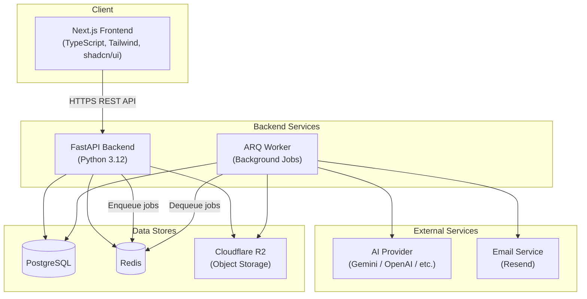
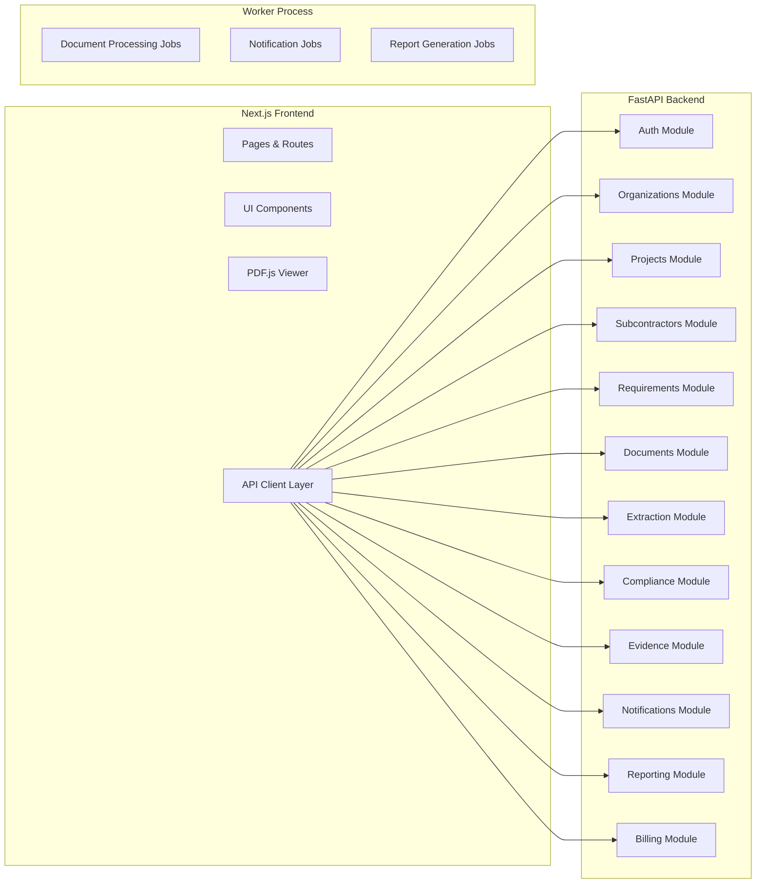
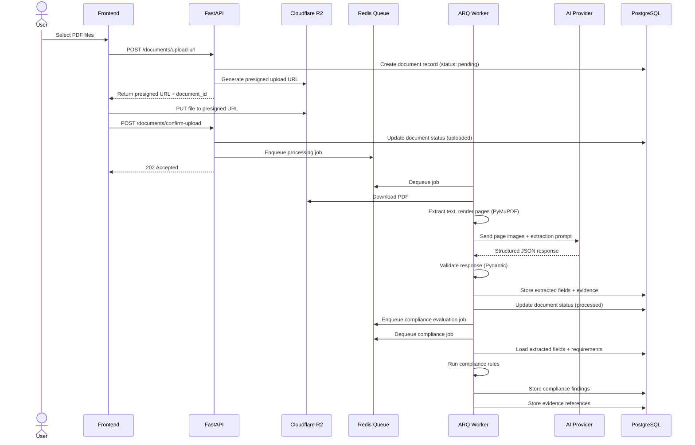
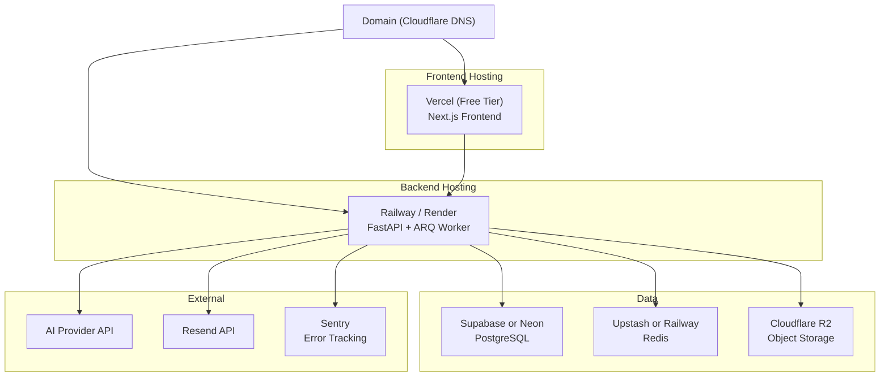

# SubGuard AI — System Architecture

> **Version:** 0.1.0 (Draft)  
> **Last Updated:** 2026-10-30  
> **Status:** Planning Phase

---

## 1. Architecture Overview

SubGuard AI uses a **modular monolith** architecture — a single deployable backend application with clearly separated internal modules that communicate through well-defined interfaces rather than HTTP calls.

### Why a Modular Monolith

| Approach | Pros | Cons | Verdict |
|---|---|---|---|
| **Microservices** | Independent scaling, team autonomy | Complex deployment, distributed debugging, network overhead, operational burden | Overkill for a solo founder |
| **Pure monolith** | Simple, single deployment | Tight coupling makes future refactoring hard | Viable but risky long-term |
| **Modular monolith** | Simple deployment, clear module boundaries, can extract services later | Requires discipline to maintain boundaries | **Selected** |

### High-Level System Diagram



---

## 2. Technology Decisions

### 2.1 Frontend: Next.js + TypeScript + Tailwind + shadcn/ui

**What:** React-based framework with server-side rendering, TypeScript for type safety, Tailwind CSS for utility-first styling, shadcn/ui for accessible component primitives.

**Why chosen:**
- Next.js provides SSR, file-based routing, and a mature ecosystem
- TypeScript catches bugs at compile time (critical for a solo founder with no code reviewer)
- Tailwind eliminates CSS naming and specificity headaches
- shadcn/ui gives us production-quality, accessible components without vendor lock-in (components are copied into the project, not imported from a package)

**Alternatives considered:**
- **Vite + React SPA** — Simpler, but loses SSR benefits and requires manual routing setup
- **Remix** — Good framework, but smaller ecosystem and less community support
- **Vue/Nuxt** — Viable, but React has a larger ecosystem for the components we need (PDF viewers, data tables)
- **SvelteKit** — Elegant but smaller ecosystem, fewer available developers if we hire

**Trade-offs:** Next.js adds complexity (SSR vs CSR decisions, deployment considerations) but the benefits for a B2B SaaS (SEO for landing page, faster initial load) outweigh the complexity.

**Cost:** Free (open source). Deployment on Vercel's free tier is possible for early development.

### 2.2 Backend: Python 3.12 + FastAPI + Pydantic + SQLAlchemy

**What:** Python web framework optimized for API development with automatic validation, serialization, and OpenAPI documentation.

**Why chosen:**
- Python has the strongest AI/ML ecosystem (critical for our extraction pipeline)
- FastAPI is async-first, which matters for I/O-heavy document processing
- Pydantic v2 provides strict validation for API inputs AND AI model outputs (double duty)
- SQLAlchemy 2.0 is the most mature Python ORM with excellent PostgreSQL support
- Automatic OpenAPI/Swagger documentation reduces frontend-backend integration friction

**Alternatives considered:**
- **Django + DRF** — More batteries included (admin panel, ORM, auth), but heavier, sync-first architecture, and Pydantic integration is bolted on rather than native. Django's ORM is less flexible than SQLAlchemy for complex queries.
- **Flask** — Too minimal; we'd end up building everything Django provides but worse
- **Litestar** — Promising FastAPI alternative, but smaller community and less battle-tested
- **Node.js/Express** — Would unify the stack with the frontend, but Python's AI ecosystem is far stronger

**Trade-offs:** We lose Django's built-in admin panel and must implement auth ourselves. This is acceptable because our auth requirements are straightforward, and the Pydantic/async benefits are significant.

**Cost:** Free (open source).

### 2.3 Database: PostgreSQL

**What:** Open-source relational database.

**Why chosen:**
- Industry standard for SaaS applications
- Excellent JSONB support (useful for flexible fields like extraction results, requirement configurations)
- Row Level Security (RLS) for defense-in-depth tenant isolation
- Mature ecosystem of tools, libraries, and hosting providers
- SQLAlchemy has first-class PostgreSQL support

**Alternatives considered:**
- **MySQL** — Viable, but weaker JSONB support, no RLS
- **MongoDB** — Document model seems tempting for variable insurance data, but relational integrity is critical for compliance data; we need JOIN-heavy queries
- **SQLite** — No concurrent writes, no network access, not suitable for multi-user SaaS

### 2.4 Managed PostgreSQL: Supabase vs Neon (EVALUATION NEEDED)

**Status: Not finalized — both options need evaluation before committing.**

| Factor | Supabase | Neon | Self-Hosted |
|---|---|---|---|
| Free tier | Yes (limited) | Yes (limited) | No (server cost) |
| Built-in auth | Yes (Supabase Auth) | No | No |
| RLS support | Yes (first-class) | Yes (PostgreSQL native) | Yes |
| Connection pooling | Built-in (PgBouncer) | Built-in | Must configure |
| Branching (dev environments) | Limited | Yes (database branching) | Manual |
| Pricing at scale | Needs evaluation | Needs evaluation | Predictable |
| Regional availability | Needs verification | Needs verification | Your choice |
| Vendor lock-in risk | Medium (proprietary features) | Low (standard PostgreSQL) | None |

**Recommendation:** Evaluate both during Phase 1 development. Start with whichever has the better developer experience for initial setup. Ensure we do NOT use any proprietary features that would make migration difficult.

**Cost:** Both offer free tiers for development. Production costs estimated at \$25-50/month initially.

### 2.5 Background Jobs: Redis + ARQ

**What:** Redis as a message broker, ARQ as a lightweight Python job queue library.

**Why chosen:**
- ARQ is async-native (matches FastAPI's async architecture)
- Lightweight — single Redis instance serves as both job queue and cache
- Simple API for defining and scheduling jobs
- Built-in retry support

**Alternatives considered:**
- **Celery** — Most popular Python task queue, but heavier, sync-first, more complex configuration, pulls in many dependencies
- **Dramatiq** — Good alternative, but ARQ's async-native design is a better fit
- **RQ (Redis Queue)** — Simpler than Celery but sync-only
- **Database-backed queue (pgq)** — Eliminates Redis dependency, but adds load to the database and lacks mature tooling

**Risk:** ARQ is a smaller project than Celery. If ARQ is unmaintained or has bugs, we may need to switch. Mitigation: our job processing code is isolated in a module that can be adapted to another queue library.

**Cost:** Redis hosting \$0-15/month (Upstash free tier, or Railway/Render managed Redis).

### 2.6 Object Storage: Cloudflare R2

**What:** S3-compatible object storage with no egress fees.

**Why chosen:**
- **No egress fees** — This is significant for a document-heavy application. Every time a user views a PDF, we'd pay egress with S3.
- S3-compatible API — standard tooling, easy migration if needed
- Competitive storage pricing

**Alternatives considered:**
- **AWS S3** — Most mature, but egress costs add up fast for document viewing (potentially \$0.09/GB)
- **Backblaze B2** — Low cost, S3-compatible, but less widely used
- **MinIO (self-hosted)** — Full control, but operational burden for a solo founder

**Trade-offs:** R2 is newer than S3. Verify: presigned URL support (confirmed — R2 supports presigned URLs), multipart upload support, and any size limits.

**Cost:** R2 free tier includes 10 GB storage and 10 million reads/month. Production: pay-as-you-go, very low for our scale.

### 2.7 PDF Processing: PyMuPDF

**What:** Python library for PDF rendering and text extraction.

**Why chosen:**
- Fast PDF rendering (can render pages to images for AI input)
- Good text extraction from text-layer PDFs
- Can extract page dimensions, metadata
- Single library covers both text extraction and image rendering

**Alternatives considered:**
- **pdfplumber** — Good text extraction, but cannot render pages to images
- **pdf2image + Poppler** — Renders pages, but requires Poppler system dependency
- **pikepdf** — Low-level PDF manipulation, not designed for text extraction
- **Tesseract OCR** — For scanned documents without text layers; may be needed as a fallback, but not primary

> [!WARNING]
> **License concern:** PyMuPDF is licensed under AGPL-3.0. For proprietary SaaS use, this may require purchasing a commercial license from Artifex Software. This needs legal verification before production deployment. Alternative: use `pypdfium2` (Apache 2.0 license) for rendering and `pdfplumber` for text extraction.

**Cost:** Free (open source AGPL) or commercial license (~\$500-2000/year, needs verification).

### 2.8 AI Provider: Abstracted

**What:** Provider-abstracted interface supporting multiple AI model providers.

**Why chosen:**
- AI model landscape changes rapidly
- Don't want vendor lock-in
- Can A/B test models for accuracy and cost
- Can switch providers if one has an outage or price increase

**Initial evaluation targets:**
- **Google Gemini Flash** — Fast, cost-effective, good multimodal capabilities
- **Google Gemini Pro** — More capable, higher cost
- **OpenAI GPT-4o mini** — Competitive multimodal, structured output support
- **Anthropic Claude Haiku** — Fast and cost-effective

**Decision criteria:** Accuracy on COI extraction, cost per document, latency, structured output reliability, bounding-box accuracy.

**Cost:** Estimated \$0.01-0.10 per document depending on model and page count.

### 2.9 Email: Resend (Tentative)

**What:** Transactional email API service.

**Why chosen:**
- Simple API, good developer experience
- Reasonable pricing (free tier: 100 emails/day)
- Good deliverability reputation

**Alternatives:** SendGrid, Postmark (best deliverability), AWS SES (cheapest at scale), Mailgun.

**Status:** Tentative — needs evaluation for deliverability of insurance-related content.

**Cost:** Free tier sufficient for MVP. Paid plans from ~\$20/month.

---

## 3. System Components

### 3.1 Component Diagram



### 3.2 Module Responsibilities

| Module | Responsibility |
|---|---|
| **auth** | Registration, login, JWT token management, password hashing, email verification, session handling |
| **organizations** | Org CRUD, settings, member management, role assignment |
| **users** | User profile management |
| **projects** | Project CRUD, status management |
| **subcontractors** | Subcontractor CRUD, project association |
| **requirements** | Requirement template CRUD, coverage type/limit configuration, endorsement requirements |
| **documents** | Upload handling, storage management, document metadata, presigned URL generation |
| **extraction** | AI provider management, extraction job orchestration, response validation, extracted field storage |
| **compliance** | Rules engine, compliance evaluation, finding generation, evidence linking |
| **evidence** | Evidence reference management, bounding-box data, source text storage |
| **notifications** | Notification creation, deduplication, email sending, in-app notification management |
| **reporting** | Report generation (compliance summary, deficiency reports, CSV/PDF export) |
| **billing** | Subscription management, usage tracking, payment provider integration (future) |

---

## 4. API Design

### 4.1 API Organization

```
/api/v1/
├── /auth/
│   ├── POST /register
│   ├── POST /login
│   ├── POST /refresh
│   ├── POST /logout
│   ├── POST /verify-email
│   └── POST /forgot-password
├── /organizations/
│   ├── GET / (list user's orgs)
│   ├── POST / (create org)
│   ├── GET /{org_id}
│   ├── PATCH /{org_id}
│   ├── GET /{org_id}/members
│   ├── POST /{org_id}/members/invite
│   └── PATCH /{org_id}/members/{member_id}
├── /projects/
│   ├── GET / (list org's projects)
│   ├── POST /
│   ├── GET /{project_id}
│   ├── PATCH /{project_id}
│   ├── GET /{project_id}/subcontractors
│   └── POST /{project_id}/subcontractors
├── /subcontractors/
│   ├── GET /
│   ├── POST /
│   ├── GET /{sub_id}
│   ├── PATCH /{sub_id}
│   ├── GET /{sub_id}/documents
│   └── GET /{sub_id}/compliance
├── /requirements/
│   ├── GET /templates
│   ├── POST /templates
│   ├── GET /templates/{template_id}
│   ├── PATCH /templates/{template_id}
│   └── POST /projects/{project_id}/requirements
├── /documents/
│   ├── POST /upload-url (get presigned upload URL)
│   ├── POST /confirm-upload (confirm upload completed)
│   ├── GET /{doc_id}
│   ├── GET /{doc_id}/download-url (get presigned download URL)
│   ├── GET /{doc_id}/extracted-fields
│   └── POST /{doc_id}/reprocess
├── /compliance/
│   ├── GET /reviews/{review_id}
│   ├── GET /reviews/{review_id}/findings
│   ├── PATCH /findings/{finding_id} (human review override)
│   └── POST /reviews/{review_id}/generate-report
├── /notifications/
│   ├── GET / (list user's notifications)
│   ├── PATCH /{notification_id}/read
│   └── POST /mark-all-read
└── /reports/
    ├── GET /compliance-overview
    ├── GET /expiring-policies
    └── GET /export/{format}
```

### 4.2 Authentication Flow

1. User sends credentials to `POST /auth/login`
2. Server validates credentials, returns:
   - Short-lived JWT access token (15-30 minutes)
   - Longer-lived refresh token (7 days), stored in HTTP-only secure cookie
3. Frontend stores access token in memory (not localStorage)
4. Frontend sends access token in `Authorization: Bearer <token>` header
5. When access token expires, frontend calls `POST /auth/refresh` with the refresh token cookie
6. Server validates refresh token, issues new access token and rotates refresh token

### 4.3 Error Handling

All API errors return a consistent structure:

```json
{
  "error": {
    "code": "VALIDATION_ERROR",
    "message": "Human-readable error message",
    "details": [
      {
        "field": "min_each_occurrence",
        "message": "Value must be a positive integer"
      }
    ],
    "request_id": "req_abc123"
  }
}
```

HTTP status codes:
- `400` — Validation error
- `401` — Not authenticated
- `403` — Not authorized
- `404` — Resource not found
- `409` — Conflict (duplicate, stale data)
- `422` — Unprocessable entity (Pydantic validation failure)
- `429` — Rate limited
- `500` — Internal server error

### 4.4 Pagination

Cursor-based pagination for list endpoints:

```json
{
  "data": [...],
  "pagination": {
    "next_cursor": "eyJpZCI6IjEyMyJ9",
    "has_more": true,
    "total_count": 156
  }
}
```

### 4.5 API Versioning

URL-based versioning (`/api/v1/`). We ship v1 and only create v2 if we need breaking changes.

---

## 5. Data Flow

### 5.1 Document Upload and Processing



### 5.2 Compliance Evaluation Flow

1. Load all extracted fields for the subcontractor's documents
2. Load applicable insurance requirements (from project or org defaults)
3. For each requirement, find the corresponding extracted field(s)
4. Run the appropriate compliance rule (limit check, date check, endorsement check)
5. Generate a finding with status, explanation, and evidence reference
6. Aggregate findings into overall compliance status
7. Store results
8. If non-compliant findings exist, generate notification

### 5.3 Deficiency Report Flow

1. User requests deficiency report for a compliance review
2. System collects all non-compliant, missing, and review-needed findings
3. System generates structured report content
4. System drafts correction-request email using findings data
5. User reviews and optionally edits the draft
6. User approves → system sends email via Resend
7. System records sent status and timestamp

---

## 6. Processing Pipeline

### 6.1 Pipeline Stages

| Stage | Input | Output | Error Handling |
|---|---|---|---|
| **1. Upload Validation** | Raw file | Validated document record | Reject invalid files; return error to user |
| **2. PDF Pre-processing** | PDF file bytes | Page images, text layers, metadata | Mark document as failed if PDF is corrupt |
| **3. Document Classification** | Page images/text | Document type (COI, endorsement, etc.) | Default to "unknown" if classification fails |
| **4. Field Extraction** | Page images + prompt | Structured extraction result | Retry up to 3 times; mark as failed if all retries fail |
| **5. Response Validation** | Raw AI response | Validated Pydantic model | Log malformed response; mark extraction as failed |
| **6. Post-processing** | Validated extraction | Normalized values | Log normalization errors; preserve raw values |
| **7. Compliance Evaluation** | Extracted fields + requirements | Compliance findings | Log evaluation errors; mark review as failed |
| **8. Evidence Linking** | Findings + source references | Evidence records | Missing evidence is a valid finding, not an error |

### 6.2 Idempotency

Every processing job includes an `idempotency_key` (typically `{document_id}:{job_type}:{version}`).

Before processing:
1. Check if a completed job exists with this idempotency key
2. If yes, skip processing (return existing result)
3. If no, proceed and create the job record

This ensures that retrying a failed job or accidentally enqueuing a duplicate does not create duplicate extracted fields or compliance findings.

### 6.3 Retry Strategy

| Failure Type | Retry? | Max Retries | Backoff |
|---|---|---|---|
| AI provider timeout | Yes | 3 | Exponential (5s, 15s, 45s) |
| AI provider rate limit | Yes | 5 | Exponential with jitter |
| AI provider server error (500) | Yes | 3 | Exponential (10s, 30s, 90s) |
| Malformed AI response | Yes | 2 | Immediate (different prompt variation) |
| PDF processing error | No | 0 | Fail permanently, notify user |
| Database error | Yes | 3 | Exponential (1s, 3s, 9s) |
| All retries exhausted | No | — | Mark as failed, notify user, allow manual retry |

---

## 7. Background Job Architecture

### 7.1 Job Types

| Job | Trigger | Priority | Timeout |
|---|---|---|---|
| `process_document` | Document upload confirmed | Normal | 5 minutes |
| `extract_fields` | Document pre-processed | Normal | 3 minutes |
| `evaluate_compliance` | Extraction completed | Normal | 1 minute |
| `generate_report` | User requests report | Normal | 2 minutes |
| `send_email` | User approves email | High | 30 seconds |
| `check_expirations` | Daily cron | Low | 5 minutes |
| `send_notification` | Various events | Normal | 30 seconds |

### 7.2 Monitoring

- Log job start, completion, failure with timing
- Track queue depth (alert if > 100 pending jobs)
- Track job duration (alert if processing time increases significantly)
- Dead letter queue for jobs that fail all retries

---

## 8. Multi-Tenancy

### Strategy: Shared Database, Row-Level Isolation

Every tenant-scoped table includes an `org_id` column that references the `organizations` table.

**Application-level enforcement (primary):**
- Every database query includes `WHERE org_id = :current_org_id`
- A middleware/dependency extracts `org_id` from the authenticated user's current organization
- No query can be constructed without an org_id filter

**Row Level Security (defense-in-depth):**
- If using Supabase, enable RLS policies on all tenant-scoped tables
- RLS acts as a safety net — if application code has a bug that omits the org_id filter, RLS prevents cross-tenant access
- RLS is NOT the primary isolation mechanism (application code is)

**Tables that are NOT tenant-scoped:**
- `users` (a user can belong to multiple orgs)
- `organization_members` (links users to orgs, but scoped queries go through org_id)

---

## 9. File Storage Architecture

### 9.1 Upload Flow

```
User selects file
    → Frontend requests presigned upload URL from backend
    → Backend validates request, creates document record, generates presigned PUT URL
    → Frontend uploads file directly to R2 (bypasses backend, saves bandwidth)
    → Frontend confirms upload with backend
    → Backend verifies file exists in R2, updates document record, enqueues processing
```

### 9.2 Storage Organization

```
bucket: subguard-documents
├── {org_id}/
│   ├── documents/
│   │   ├── {document_id}/
│   │   │   ├── original.pdf
│   │   │   └── pages/
│   │   │       ├── page_001.png
│   │   │       ├── page_002.png
│   │   │       └── ...
│   └── reports/
│       └── {report_id}.pdf
```

### 9.3 Access Control

- **No public access** — All bucket-level policies deny public read
- **Presigned download URLs** — Generated per-request after authorization check, 15-minute expiry
- **Presigned upload URLs** — Generated with file-size limits and content-type restrictions

---

## 10. Caching Strategy

| What | Cache Location | TTL | Invalidation |
|---|---|---|---|
| User session data | Redis | 30 minutes | On logout or role change |
| Organization settings | Redis | 1 hour | On settings update |
| Requirement templates | Redis | 1 hour | On template update |
| Static lists (coverage types, enums) | Application memory | Indefinite | On deploy |
| Document download URLs | Not cached | — | Generated per-request |

Keep caching minimal in MVP. Premature caching adds complexity and stale-data bugs.

---

## 11. Error Handling

### Global Error Handling

```python
@app.exception_handler(AppError)
async def app_error_handler(request, exc):
    return JSONResponse(
        status_code=exc.status_code,
        content={
            "error": {
                "code": exc.error_code,
                "message": exc.message,
                "details": exc.details,
                "request_id": request.state.request_id,
            }
        },
    )
```

### Error Classification

| Category | HTTP Code | Example | Action |
|---|---|---|---|
| Validation | 400/422 | Invalid input | Return details, don't retry |
| Authentication | 401 | Expired token | Client refreshes token |
| Authorization | 403 | Wrong org | Log, don't retry |
| Not Found | 404 | Bad resource ID | Return not found |
| Rate Limit | 429 | Too many requests | Client retries with backoff |
| Server Error | 500 | Unexpected exception | Log, alert, client retries |

---

## 12. Deployment Architecture

### Initial Deployment (Budget-Conscious)



### Estimated Monthly Cost (Early Stage)

| Service | Free Tier | Paid Estimate |
|---|---|---|
| Vercel (frontend) | Yes | \$0 |
| Railway/Render (backend) | Limited | \$5-20/month |
| PostgreSQL (Supabase/Neon) | Yes | \$0-25/month |
| Redis (Upstash) | Yes | \$0-10/month |
| Cloudflare R2 | 10 GB free | \$0-5/month |
| AI API calls | Pay-per-use | \$5-50/month (depends on volume) |
| Resend | 100/day free | \$0-20/month |
| Domain | — | \$10-15/year |
| Sentry | Free tier | \$0 |
| **Total** | — | **~\$20-145/month** |

---

## 13. Scalability Considerations (Future)

These are NOT needed for MVP but should inform architecture decisions:

- **Database read replicas** — If read load exceeds single instance
- **Worker horizontal scaling** — Run multiple ARQ workers behind the same Redis queue
- **CDN for static assets** — Already handled by Vercel/Cloudflare
- **Database connection pooling** — PgBouncer or built-in pooling from managed provider
- **Queue partitioning** — Separate queues for different job priorities

---

## 14. Monitoring and Observability

### MVP Requirements

| Capability | Tool | Priority |
|---|---|---|
| Error tracking | Sentry (free tier) | P0 |
| Application logging | Structured JSON logs (stdout) | P0 |
| Health check endpoint | `GET /health` — checks DB and Redis | P0 |
| Uptime monitoring | UptimeRobot (free) or Betterstack | P1 |
| Request tracing | Request ID in all logs and responses | P1 |
| Basic metrics | Log-based (request count, latency, error rate) | P2 |
| Dashboard | Defer until needed | P2 |

### Health Check Response

```json
{
  "status": "healthy",
  "version": "0.1.0",
  "checks": {
    "database": "ok",
    "redis": "ok",
    "storage": "ok"
  },
  "timestamp": "2025-01-15T10:30:00Z"
}
```

---

*This document will be updated as architectural decisions are finalized and implementation begins.*
