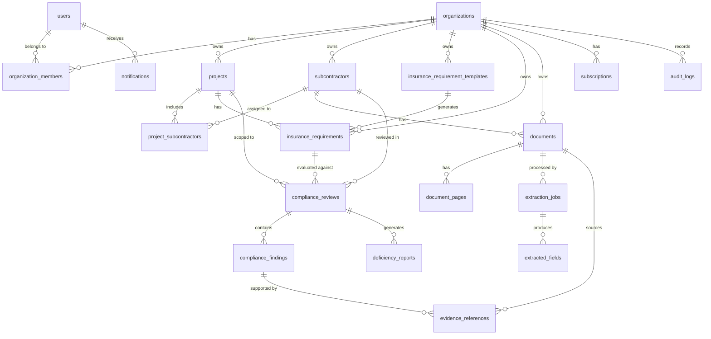

# SubGuard AI — Database Schema Design

> **Version:** 0.1.0 (Draft)  
> **Last Updated:** 2026-10-30  
> **Status:** Planning Phase

---

## 1. Overview

### Design Philosophy

- **Normalized relational schema** — No data duplication; referential integrity enforced at the database level
- **Multi-tenant via `org_id`** — Every tenant-scoped table has an `org_id` column; every query filters by it
- **UUIDs for primary keys** — Not guessable (security benefit), safe for distributed generation
- **Money in cents (bigint)** — Avoids floating-point rounding errors in insurance limit comparisons
- **Timestamps with timezone** — All `created_at`/`updated_at` use `TIMESTAMP WITH TIME ZONE`, defaulting to UTC
- **JSONB for flexible structures** — Used where schema variability is expected (settings, raw AI responses, additional conditions)
- **Soft deletes for business entities** — `is_active` flag rather than hard delete for auditable data
- **Alembic for migrations** — Schema changes are versioned and reversible

---

## 2. Entity-Relationship Diagram



---

## 3. Tenant Isolation Strategy

### Primary Mechanism: Application-Level Filtering

Every database query for tenant-scoped data MUST include `WHERE org_id = :current_org_id`. This is enforced at the repository/service layer.

```python
# Example: Every repository method receives org_id
async def get_subcontractors(self, org_id: UUID, ...) -> list[Subcontractor]:
    query = select(Subcontractor).where(
        Subcontractor.org_id == org_id,
        Subcontractor.is_active == True,
    )
    ...
```

### Secondary Mechanism: Row Level Security (Defense-in-Depth)

If using Supabase or configuring RLS manually:

```sql
-- Example RLS policy
ALTER TABLE subcontractors ENABLE ROW LEVEL SECURITY;

CREATE POLICY "tenant_isolation" ON subcontractors
    USING (org_id = current_setting('app.current_org_id')::uuid);
```

RLS is a safety net. If application code accidentally omits an `org_id` filter, RLS prevents cross-tenant data exposure. It is NOT the primary mechanism.

### Tables NOT Tenant-Scoped

- `users` — A user can belong to multiple organizations
- `organization_members` — Junction table between users and orgs (queries go through org_id or user_id)

---

## 4. Detailed Table Definitions

### 4.1 `users`

**Purpose:** Stores user accounts. NOT tenant-scoped.

| Column | Type | Constraints | Description |
|---|---|---|---|
| `id` | UUID | PK, DEFAULT gen_random_uuid() | |
| `email` | VARCHAR(255) | UNIQUE, NOT NULL | Login identifier |
| `password_hash` | VARCHAR(255) | NOT NULL | bcrypt or argon2 hash |
| `full_name` | VARCHAR(255) | NOT NULL | Display name |
| `avatar_url` | VARCHAR(500) | NULLABLE | Profile image URL |
| `email_verified` | BOOLEAN | NOT NULL, DEFAULT FALSE | Email confirmation status |
| `is_active` | BOOLEAN | NOT NULL, DEFAULT TRUE | Account active status |
| `last_login_at` | TIMESTAMPTZ | NULLABLE | Last successful login |
| `created_at` | TIMESTAMPTZ | NOT NULL, DEFAULT NOW() | |
| `updated_at` | TIMESTAMPTZ | NOT NULL, DEFAULT NOW() | |

**Indexes:**
- `idx_users_email` UNIQUE on `email`

---

### 4.2 `organizations`

**Purpose:** Tenant/workspace. All tenant-scoped data references this table.

| Column | Type | Constraints | Description |
|---|---|---|---|
| `id` | UUID | PK | |
| `name` | VARCHAR(255) | NOT NULL | Organization display name |
| `slug` | VARCHAR(100) | UNIQUE, NOT NULL | URL-friendly identifier |
| `settings` | JSONB | NOT NULL, DEFAULT '{}' | Org-level settings (e.g., default requirement template, notification preferences) |
| `subscription_tier` | VARCHAR(50) | NOT NULL, DEFAULT 'free' | Current plan |
| `is_active` | BOOLEAN | NOT NULL, DEFAULT TRUE | |
| `created_at` | TIMESTAMPTZ | NOT NULL, DEFAULT NOW() | |
| `updated_at` | TIMESTAMPTZ | NOT NULL, DEFAULT NOW() | |

**Indexes:**
- `idx_organizations_slug` UNIQUE on `slug`

---

### 4.3 `organization_members`

**Purpose:** Links users to organizations with roles.

| Column | Type | Constraints | Description |
|---|---|---|---|
| `id` | UUID | PK | |
| `org_id` | UUID | FK → organizations(id), NOT NULL | |
| `user_id` | UUID | FK → users(id), NOT NULL | |
| `role` | VARCHAR(50) | NOT NULL, DEFAULT 'member' | Enum: owner, admin, member, viewer |
| `invited_by` | UUID | FK → users(id), NULLABLE | Who sent the invite |
| `invited_at` | TIMESTAMPTZ | NULLABLE | When invite was sent |
| `accepted_at` | TIMESTAMPTZ | NULLABLE | When invite was accepted |
| `is_active` | BOOLEAN | NOT NULL, DEFAULT TRUE | |
| `created_at` | TIMESTAMPTZ | NOT NULL, DEFAULT NOW() | |
| `updated_at` | TIMESTAMPTZ | NOT NULL, DEFAULT NOW() | |

**Indexes:**
- `uq_org_members_org_user` UNIQUE on `(org_id, user_id)`
- `idx_org_members_user` on `user_id` (find user's orgs)

---

### 4.4 `projects`

**Purpose:** Construction projects within an organization.

| Column | Type | Constraints | Description |
|---|---|---|---|
| `id` | UUID | PK | |
| `org_id` | UUID | FK → organizations(id), NOT NULL | Tenant ownership |
| `name` | VARCHAR(255) | NOT NULL | Project name |
| `description` | TEXT | NULLABLE | |
| `status` | VARCHAR(50) | NOT NULL, DEFAULT 'active' | Enum: active, completed, archived |
| `address` | TEXT | NULLABLE | Project site address |
| `start_date` | DATE | NULLABLE | |
| `end_date` | DATE | NULLABLE | |
| `created_by` | UUID | FK → users(id), NOT NULL | |
| `created_at` | TIMESTAMPTZ | NOT NULL, DEFAULT NOW() | |
| `updated_at` | TIMESTAMPTZ | NOT NULL, DEFAULT NOW() | |

**Indexes:**
- `idx_projects_org` on `org_id`
- `idx_projects_org_status` on `(org_id, status)`

---

### 4.5 `subcontractors`

**Purpose:** Subcontractor businesses tracked by the organization.

| Column | Type | Constraints | Description |
|---|---|---|---|
| `id` | UUID | PK | |
| `org_id` | UUID | FK → organizations(id), NOT NULL | Tenant ownership |
| `business_name` | VARCHAR(255) | NOT NULL | Legal business name |
| `contact_name` | VARCHAR(255) | NULLABLE | Primary contact person |
| `contact_email` | VARCHAR(255) | NULLABLE | |
| `contact_phone` | VARCHAR(50) | NULLABLE | |
| `address` | TEXT | NULLABLE | |
| `trade` | VARCHAR(100) | NULLABLE | Trade/specialty (electrician, plumber, etc.) |
| `notes` | TEXT | NULLABLE | |
| `is_active` | BOOLEAN | NOT NULL, DEFAULT TRUE | |
| `created_at` | TIMESTAMPTZ | NOT NULL, DEFAULT NOW() | |
| `updated_at` | TIMESTAMPTZ | NOT NULL, DEFAULT NOW() | |

**Indexes:**
- `idx_subcontractors_org` on `org_id`
- `idx_subcontractors_org_name` on `(org_id, business_name)`

---

### 4.6 `project_subcontractors`

**Purpose:** Many-to-many relationship between projects and subcontractors.

| Column | Type | Constraints | Description |
|---|---|---|---|
| `id` | UUID | PK | |
| `project_id` | UUID | FK → projects(id), NOT NULL | |
| `subcontractor_id` | UUID | FK → subcontractors(id), NOT NULL | |
| `org_id` | UUID | FK → organizations(id), NOT NULL | Denormalized for RLS |
| `added_at` | TIMESTAMPTZ | NOT NULL, DEFAULT NOW() | |

**Indexes:**
- `uq_project_sub` UNIQUE on `(project_id, subcontractor_id)`
- `idx_project_subs_org` on `org_id`

---

### 4.7 `insurance_requirement_templates`

**Purpose:** Reusable sets of insurance requirements (e.g., "Standard Sub Requirements").

| Column | Type | Constraints | Description |
|---|---|---|---|
| `id` | UUID | PK | |
| `org_id` | UUID | FK → organizations(id), NOT NULL | |
| `name` | VARCHAR(255) | NOT NULL | Template name |
| `description` | TEXT | NULLABLE | |
| `is_default` | BOOLEAN | NOT NULL, DEFAULT FALSE | Org's default template |
| `created_by` | UUID | FK → users(id), NOT NULL | |
| `is_active` | BOOLEAN | NOT NULL, DEFAULT TRUE | |
| `created_at` | TIMESTAMPTZ | NOT NULL, DEFAULT NOW() | |
| `updated_at` | TIMESTAMPTZ | NOT NULL, DEFAULT NOW() | |

**Indexes:**
- `idx_req_templates_org` on `org_id`

---

### 4.8 `insurance_requirements`

**Purpose:** Individual insurance requirements, either from a template or assigned directly to a project.

| Column | Type | Constraints | Description |
|---|---|---|---|
| `id` | UUID | PK | |
| `org_id` | UUID | FK → organizations(id), NOT NULL | |
| `template_id` | UUID | FK → insurance_requirement_templates(id), NULLABLE | Source template (null if project-specific) |
| `project_id` | UUID | FK → projects(id), NULLABLE | Specific project (null if template-level) |
| `coverage_type` | VARCHAR(50) | NOT NULL | Enum: general_liability, auto_liability, workers_comp, umbrella_excess, professional_liability, other |
| `min_each_occurrence` | BIGINT | NULLABLE | Minimum in cents |
| `min_general_aggregate` | BIGINT | NULLABLE | Minimum in cents |
| `min_products_completed_ops` | BIGINT | NULLABLE | Minimum in cents |
| `min_personal_adv_injury` | BIGINT | NULLABLE | Minimum in cents |
| `min_combined_single_limit` | BIGINT | NULLABLE | Minimum in cents (auto) |
| `min_per_accident` | BIGINT | NULLABLE | Minimum in cents (WC) |
| `min_disease_each_employee` | BIGINT | NULLABLE | Minimum in cents (WC) |
| `min_disease_policy_limit` | BIGINT | NULLABLE | Minimum in cents (WC) |
| `require_additional_insured` | BOOLEAN | NOT NULL, DEFAULT FALSE | |
| `require_waiver_of_subrogation` | BOOLEAN | NOT NULL, DEFAULT FALSE | |
| `require_primary_noncontributory` | BOOLEAN | NOT NULL, DEFAULT FALSE | |
| `additional_conditions` | JSONB | NOT NULL, DEFAULT '{}' | Flexible extra conditions |
| `is_active` | BOOLEAN | NOT NULL, DEFAULT TRUE | |
| `created_at` | TIMESTAMPTZ | NOT NULL, DEFAULT NOW() | |
| `updated_at` | TIMESTAMPTZ | NOT NULL, DEFAULT NOW() | |

**Indexes:**
- `idx_requirements_org` on `org_id`
- `idx_requirements_template` on `template_id`
- `idx_requirements_project` on `project_id`

> [!NOTE]
> **Why cents (bigint)?** Insurance limits are always whole dollar amounts (\$1,000,000 = 100,000,000 cents). Storing as bigint avoids floating-point comparison errors. For example, `0.1 + 0.2 != 0.3` in floating point, but `10 + 20 == 30` in integers. This matters when comparing "does the extracted limit meet the required minimum?"

---

### 4.9 `documents`

**Purpose:** Uploaded PDF files.

| Column | Type | Constraints | Description |
|---|---|---|---|
| `id` | UUID | PK | |
| `org_id` | UUID | FK → organizations(id), NOT NULL | |
| `subcontractor_id` | UUID | FK → subcontractors(id), NOT NULL | |
| `project_id` | UUID | FK → projects(id), NULLABLE | Specific project context |
| `document_type` | VARCHAR(50) | NOT NULL, DEFAULT 'unknown' | Enum: coi, endorsement, policy_dec_page, other, unknown |
| `original_filename` | VARCHAR(255) | NOT NULL | User's original filename |
| `storage_key` | VARCHAR(500) | NOT NULL | R2 object key |
| `file_size_bytes` | BIGINT | NOT NULL | |
| `mime_type` | VARCHAR(100) | NOT NULL | |
| `content_hash` | VARCHAR(64) | NOT NULL | SHA-256 of file content |
| `page_count` | INTEGER | NULLABLE | Populated after processing |
| `upload_status` | VARCHAR(50) | NOT NULL, DEFAULT 'pending' | Enum: pending, uploaded, processing, processed, failed |
| `processing_error` | TEXT | NULLABLE | Error message if processing failed |
| `uploaded_by` | UUID | FK → users(id), NOT NULL | |
| `created_at` | TIMESTAMPTZ | NOT NULL, DEFAULT NOW() | |
| `updated_at` | TIMESTAMPTZ | NOT NULL, DEFAULT NOW() | |

**Indexes:**
- `idx_documents_org` on `org_id`
- `idx_documents_sub` on `subcontractor_id`
- `idx_documents_org_sub` on `(org_id, subcontractor_id)`
- `idx_documents_content_hash` on `(org_id, content_hash)` — detect duplicate uploads

---

### 4.10 `document_pages`

**Purpose:** Individual pages of a document.

| Column | Type | Constraints | Description |
|---|---|---|---|
| `id` | UUID | PK | |
| `document_id` | UUID | FK → documents(id), NOT NULL | |
| `org_id` | UUID | FK → organizations(id), NOT NULL | |
| `page_number` | INTEGER | NOT NULL | 1-indexed |
| `storage_key` | VARCHAR(500) | NULLABLE | R2 key for rendered page image |
| `width_px` | INTEGER | NULLABLE | Page width in pixels |
| `height_px` | INTEGER | NULLABLE | Page height in pixels |
| `text_content` | TEXT | NULLABLE | Extracted text layer |
| `created_at` | TIMESTAMPTZ | NOT NULL, DEFAULT NOW() | |

**Indexes:**
- `uq_doc_pages_doc_page` UNIQUE on `(document_id, page_number)`
- `idx_doc_pages_org` on `org_id`

---

### 4.11 `extraction_jobs`

**Purpose:** Tracks each AI extraction attempt on a document.

| Column | Type | Constraints | Description |
|---|---|---|---|
| `id` | UUID | PK | |
| `org_id` | UUID | FK → organizations(id), NOT NULL | |
| `document_id` | UUID | FK → documents(id), NOT NULL | |
| `status` | VARCHAR(50) | NOT NULL, DEFAULT 'pending' | Enum: pending, in_progress, completed, failed, cancelled |
| `ai_provider` | VARCHAR(100) | NULLABLE | e.g., "google", "openai" |
| `ai_model` | VARCHAR(100) | NULLABLE | e.g., "gemini-2.0-flash" |
| `prompt_version` | VARCHAR(50) | NULLABLE | Tracks which prompt was used |
| `started_at` | TIMESTAMPTZ | NULLABLE | |
| `completed_at` | TIMESTAMPTZ | NULLABLE | |
| `error_message` | TEXT | NULLABLE | |
| `retry_count` | INTEGER | NOT NULL, DEFAULT 0 | |
| `idempotency_key` | VARCHAR(255) | UNIQUE, NOT NULL | Prevents duplicate processing |
| `raw_response` | JSONB | NULLABLE | Full AI response for debugging |
| `token_count_input` | INTEGER | NULLABLE | For cost tracking |
| `token_count_output` | INTEGER | NULLABLE | |
| `processing_time_ms` | INTEGER | NULLABLE | |
| `created_at` | TIMESTAMPTZ | NOT NULL, DEFAULT NOW() | |
| `updated_at` | TIMESTAMPTZ | NOT NULL, DEFAULT NOW() | |

**Indexes:**
- `uq_extraction_idempotency` UNIQUE on `idempotency_key`
- `idx_extraction_org` on `org_id`
- `idx_extraction_document` on `document_id`
- `idx_extraction_status` on `(org_id, status)`

---

### 4.12 `extracted_fields`

**Purpose:** Individual fields extracted from a document by AI.

| Column | Type | Constraints | Description |
|---|---|---|---|
| `id` | UUID | PK | |
| `extraction_job_id` | UUID | FK → extraction_jobs(id), NOT NULL | |
| `org_id` | UUID | FK → organizations(id), NOT NULL | |
| `document_id` | UUID | FK → documents(id), NOT NULL | |
| `field_name` | VARCHAR(100) | NOT NULL | e.g., "gl_each_occurrence", "named_insured" |
| `field_category` | VARCHAR(50) | NOT NULL | e.g., "coverage_limit", "policy_date", "entity", "endorsement" |
| `field_value` | JSONB | NOT NULL | Structured value (amount, date, name, etc.) |
| `extraction_status` | VARCHAR(50) | NOT NULL | Enum: extracted, not_found, uncertain, partial, error |
| `confidence_score` | REAL | NULLABLE | 0.0 to 1.0 |
| `source_text` | TEXT | NULLABLE | Exact text from document supporting this value |
| `page_number` | INTEGER | NULLABLE | Source page (1-indexed) |
| `bounding_box` | JSONB | NULLABLE | {"x": 0.1, "y": 0.2, "width": 0.3, "height": 0.05} — normalized 0-1 |
| `notes` | TEXT | NULLABLE | |
| `created_at` | TIMESTAMPTZ | NOT NULL, DEFAULT NOW() | |

**Indexes:**
- `idx_extracted_org` on `org_id`
- `idx_extracted_document` on `document_id`
- `idx_extracted_job` on `extraction_job_id`
- `idx_extracted_field` on `(document_id, field_name)`

---

### 4.13 `compliance_reviews`

**Purpose:** A compliance review of a subcontractor against a set of requirements.

| Column | Type | Constraints | Description |
|---|---|---|---|
| `id` | UUID | PK | |
| `org_id` | UUID | FK → organizations(id), NOT NULL | |
| `subcontractor_id` | UUID | FK → subcontractors(id), NOT NULL | |
| `project_id` | UUID | FK → projects(id), NULLABLE | |
| `requirement_id` | UUID | FK → insurance_requirements(id), NOT NULL | |
| `status` | VARCHAR(50) | NOT NULL, DEFAULT 'pending' | Enum: pending, in_progress, completed, requires_review |
| `overall_result` | VARCHAR(50) | NULLABLE | Enum: compliant, non_compliant, partial, unable_to_determine, requires_human_review |
| `reviewed_by` | UUID | FK → users(id), NULLABLE | Human reviewer |
| `reviewed_at` | TIMESTAMPTZ | NULLABLE | |
| `notes` | TEXT | NULLABLE | |
| `created_at` | TIMESTAMPTZ | NOT NULL, DEFAULT NOW() | |
| `updated_at` | TIMESTAMPTZ | NOT NULL, DEFAULT NOW() | |

**Indexes:**
- `idx_reviews_org` on `org_id`
- `idx_reviews_sub` on `(org_id, subcontractor_id)`
- `idx_reviews_project` on `(org_id, project_id)`
- `idx_reviews_status` on `(org_id, overall_result)`

---

### 4.14 `compliance_findings`

**Purpose:** Individual findings within a compliance review.

| Column | Type | Constraints | Description |
|---|---|---|---|
| `id` | UUID | PK | |
| `compliance_review_id` | UUID | FK → compliance_reviews(id), NOT NULL | |
| `org_id` | UUID | FK → organizations(id), NOT NULL | |
| `finding_type` | VARCHAR(50) | NOT NULL | Enum: coverage_limit, policy_date, endorsement, named_insured, other |
| `status` | VARCHAR(50) | NOT NULL | Enum: compliant, non_compliant, missing_evidence, unable_to_determine, requires_human_review |
| `rule_id` | VARCHAR(100) | NOT NULL | Which rule produced this finding |
| `required_value` | JSONB | NULLABLE | What was required |
| `found_value` | JSONB | NULLABLE | What was found in documents |
| `explanation` | TEXT | NOT NULL | Human-readable explanation |
| `severity` | VARCHAR(50) | NOT NULL, DEFAULT 'major' | Enum: critical, major, minor, info |
| `human_override_status` | VARCHAR(50) | NULLABLE | If human reviewed: confirmed, overridden |
| `human_override_by` | UUID | FK → users(id), NULLABLE | |
| `human_override_at` | TIMESTAMPTZ | NULLABLE | |
| `human_override_notes` | TEXT | NULLABLE | |
| `created_at` | TIMESTAMPTZ | NOT NULL, DEFAULT NOW() | |

**Indexes:**
- `idx_findings_review` on `compliance_review_id`
- `idx_findings_org` on `org_id`
- `idx_findings_status` on `(org_id, status)`

---

### 4.15 `evidence_references`

**Purpose:** Links a compliance finding to the document evidence that supports it.

| Column | Type | Constraints | Description |
|---|---|---|---|
| `id` | UUID | PK | |
| `compliance_finding_id` | UUID | FK → compliance_findings(id), NOT NULL | |
| `org_id` | UUID | FK → organizations(id), NOT NULL | |
| `document_id` | UUID | FK → documents(id), NOT NULL | |
| `extracted_field_id` | UUID | FK → extracted_fields(id), NULLABLE | Link to specific extracted field |
| `page_number` | INTEGER | NOT NULL | |
| `source_text` | TEXT | NULLABLE | Verbatim text from document |
| `bounding_box` | JSONB | NULLABLE | Highlight region |
| `created_at` | TIMESTAMPTZ | NOT NULL, DEFAULT NOW() | |

**Indexes:**
- `idx_evidence_finding` on `compliance_finding_id`
- `idx_evidence_org` on `org_id`
- `idx_evidence_document` on `document_id`

---

### 4.16 `deficiency_reports`

**Purpose:** Generated deficiency reports and email drafts.

| Column | Type | Constraints | Description |
|---|---|---|---|
| `id` | UUID | PK | |
| `org_id` | UUID | FK → organizations(id), NOT NULL | |
| `compliance_review_id` | UUID | FK → compliance_reviews(id), NOT NULL | |
| `subcontractor_id` | UUID | FK → subcontractors(id), NOT NULL | |
| `status` | VARCHAR(50) | NOT NULL, DEFAULT 'draft' | Enum: draft, pending_approval, approved, sent, acknowledged, resolved |
| `generated_content` | JSONB | NOT NULL | Structured report data |
| `email_draft` | TEXT | NULLABLE | Email body text |
| `approved_by` | UUID | FK → users(id), NULLABLE | |
| `approved_at` | TIMESTAMPTZ | NULLABLE | |
| `sent_at` | TIMESTAMPTZ | NULLABLE | |
| `sent_to_email` | VARCHAR(255) | NULLABLE | |
| `resolved_at` | TIMESTAMPTZ | NULLABLE | |
| `created_at` | TIMESTAMPTZ | NOT NULL, DEFAULT NOW() | |
| `updated_at` | TIMESTAMPTZ | NOT NULL, DEFAULT NOW() | |

**Indexes:**
- `idx_deficiency_org` on `org_id`
- `idx_deficiency_sub` on `(org_id, subcontractor_id)`
- `idx_deficiency_status` on `(org_id, status)`

---

### 4.17 `notifications`

**Purpose:** In-app and email notifications.

| Column | Type | Constraints | Description |
|---|---|---|---|
| `id` | UUID | PK | |
| `org_id` | UUID | FK → organizations(id), NOT NULL | |
| `user_id` | UUID | FK → users(id), NULLABLE | Null = org-wide notification |
| `type` | VARCHAR(50) | NOT NULL | Enum: expiration_warning, deficiency_found, review_completed, document_processed, correction_requested |
| `title` | VARCHAR(255) | NOT NULL | |
| `message` | TEXT | NOT NULL | |
| `is_read` | BOOLEAN | NOT NULL, DEFAULT FALSE | |
| `read_at` | TIMESTAMPTZ | NULLABLE | |
| `reference_type` | VARCHAR(50) | NULLABLE | e.g., "document", "compliance_review", "subcontractor" |
| `reference_id` | UUID | NULLABLE | ID of the referenced entity |
| `scheduled_for` | TIMESTAMPTZ | NULLABLE | For scheduled notifications (expirations) |
| `sent_at` | TIMESTAMPTZ | NULLABLE | When email notification was sent |
| `created_at` | TIMESTAMPTZ | NOT NULL, DEFAULT NOW() | |

**Indexes:**
- `idx_notifications_user` on `(org_id, user_id, is_read)`
- `idx_notifications_scheduled` on `(scheduled_for)` WHERE `sent_at IS NULL`
- `uq_notifications_dedup` UNIQUE on `(org_id, type, reference_type, reference_id, scheduled_for)` — prevents duplicate notifications

---

### 4.18 `audit_logs`

**Purpose:** Immutable log of important actions for compliance and debugging.

| Column | Type | Constraints | Description |
|---|---|---|---|
| `id` | UUID | PK | |
| `org_id` | UUID | FK → organizations(id), NOT NULL | |
| `user_id` | UUID | FK → users(id), NULLABLE | Null for system actions |
| `action` | VARCHAR(100) | NOT NULL | e.g., "document.uploaded", "compliance.reviewed", "member.invited" |
| `entity_type` | VARCHAR(50) | NOT NULL | e.g., "document", "subcontractor", "compliance_review" |
| `entity_id` | UUID | NULLABLE | |
| `old_values` | JSONB | NULLABLE | Before state (for updates) |
| `new_values` | JSONB | NULLABLE | After state |
| `ip_address` | VARCHAR(45) | NULLABLE | IPv4 or IPv6 |
| `user_agent` | VARCHAR(500) | NULLABLE | |
| `created_at` | TIMESTAMPTZ | NOT NULL, DEFAULT NOW() | Immutable — no updated_at |

**Indexes:**
- `idx_audit_org` on `org_id`
- `idx_audit_entity` on `(org_id, entity_type, entity_id)`
- `idx_audit_created` on `created_at`
- `idx_audit_user` on `(org_id, user_id)`

> [!IMPORTANT]
> Audit logs should **never** be updated or deleted. They are append-only. Do not add an `updated_at` column.

---

### 4.19 `subscriptions`

**Purpose:** Organization billing and subscription status.

| Column | Type | Constraints | Description |
|---|---|---|---|
| `id` | UUID | PK | |
| `org_id` | UUID | FK → organizations(id), UNIQUE, NOT NULL | One subscription per org |
| `plan` | VARCHAR(50) | NOT NULL, DEFAULT 'free' | Enum: free, starter, professional, enterprise |
| `status` | VARCHAR(50) | NOT NULL, DEFAULT 'active' | Enum: active, past_due, cancelled, trialing |
| `current_period_start` | TIMESTAMPTZ | NULLABLE | |
| `current_period_end` | TIMESTAMPTZ | NULLABLE | |
| `external_provider` | VARCHAR(50) | NULLABLE | e.g., "stripe", "paddle" |
| `external_subscription_id` | VARCHAR(255) | NULLABLE | Provider's subscription ID |
| `created_at` | TIMESTAMPTZ | NOT NULL, DEFAULT NOW() | |
| `updated_at` | TIMESTAMPTZ | NOT NULL, DEFAULT NOW() | |

**Indexes:**
- `uq_subscriptions_org` UNIQUE on `org_id`

---

## 5. Indexing Strategy

### Critical Indexes

| Index | Reason |
|---|---|
| Foreign key columns | PostgreSQL does NOT auto-index FK columns; without them, ON DELETE CASCADE and JOIN performance degrades significantly |
| `org_id` on all tenant tables | Every query filters by org_id; without index, full table scans |
| `(org_id, status)` combinations | Common filter pattern: "show me active projects in my org" |
| `idempotency_key` on extraction_jobs | Must be unique and quickly queryable for duplicate detection |
| `content_hash` on documents | Detect duplicate file uploads |
| Notification dedup unique index | Prevent duplicate notifications for the same event |
| Audit log time range | Audit queries often filter by date range |

### Index Convention

- Name format: `idx_{table}_{columns}` or `uq_{table}_{columns}` for unique
- Composite indexes: put the more selective column first
- Avoid over-indexing: each index slows writes; add indexes based on actual query patterns

---

## 6. Data Types and Conventions

| Convention | Rule |
|---|---|
| Primary keys | UUID v4 (generated in application or database) |
| Timestamps | `TIMESTAMP WITH TIME ZONE`, always stored as UTC |
| Money | `BIGINT` in cents (\$1,000,000 = 100000000) |
| Enums | `VARCHAR(50)` with application-level validation (not PostgreSQL ENUM type — easier to add values without migrations) |
| Flexible data | `JSONB` with documented structure |
| Boolean flags | `BOOLEAN NOT NULL DEFAULT FALSE/TRUE` |
| Strings | `VARCHAR(n)` with reasonable limits, or `TEXT` for unbounded content |

> [!TIP]
> **Why VARCHAR instead of PostgreSQL ENUM?** Adding a new value to a PostgreSQL ENUM type requires an ALTER TYPE migration. With VARCHAR + application-level validation (Pydantic enums), adding new status values only requires a code change, not a database migration. This is simpler for a fast-moving MVP.

---

## 7. Migration Strategy

### Alembic

- All schema changes managed through Alembic migrations
- Each migration has an `upgrade()` and `downgrade()` function
- Migrations are committed to source control
- Convention: one migration per logical change (not per table)

### Development Workflow

```bash
# Create a new migration
alembic revision --autogenerate -m "add_endorsement_type_column"

# Apply migrations
alembic upgrade head

# Rollback one step
alembic downgrade -1
```

### Production Rules

- Never modify a committed migration
- Test migrations against a copy of production data before deploying
- Keep migrations small and focused
- Always ensure downgrade works (test it)

---

## 8. Soft Deletes vs Hard Deletes

| Entity Type | Strategy | Reason |
|---|---|---|
| Users | Soft delete (`is_active`) | May need to reference in audit logs |
| Organizations | Soft delete | Data retention obligations |
| Projects, Subcontractors | Soft delete | Business data with audit trail |
| Documents | Soft delete (mark inactive) + scheduled hard delete of files | Retention policy for storage costs |
| Extraction jobs, Extracted fields | Hard delete when document is hard deleted | Derived data, can be regenerated |
| Compliance reviews, Findings | Soft delete | Audit trail of compliance decisions |
| Notifications | Hard delete after 90 days | Transient data |
| Audit logs | **Never delete** | Compliance requirement |

---

## 9. Future Considerations

- **Partitioning `audit_logs` by date** — When the table grows large, partition by `created_at` month for efficient time-range queries and easy archival
- **Read replicas** — If read load exceeds single instance capacity
- **Connection pooling** — PgBouncer (or built-in from managed provider) to handle many concurrent connections from API + worker processes
- **Full-text search** — PostgreSQL `tsvector` for searching documents, subcontractors, findings by text content
- **Archival** — Move old audit logs and processed data to cheaper storage after defined retention period

---

*This document will be updated as the schema evolves during implementation.*
