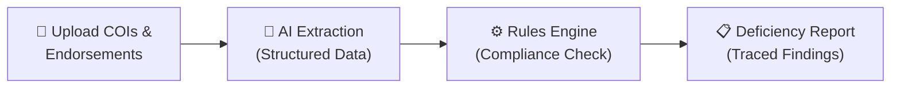

# SubGuard AI

<!--  -->
<!--  -->

**AI-powered insurance certificate compliance automation for general contractors.**

---

## Overview

SubGuard AI automates the review of Certificates of Insurance (COIs) and endorsement documents that general contractors collect from subcontractors. Instead of manually cross-referencing ACORD 25 forms against contract requirements, contractors upload documents and receive structured compliance reports — with every finding traced back to its source.

The system follows a deliberate design principle: **AI extracts, deterministic code evaluates, humans resolve uncertainty.** Multimodal AI handles document parsing and data extraction into structured formats. A Python rules engine then applies compliance logic with no ambiguity — no AI "judgment calls" on whether coverage limits are met. When the system encounters something it cannot confidently parse or evaluate, it flags it for human review rather than guessing.

SubGuard AI is designed for small-to-medium general contractors in the US who manage insurance compliance across dozens or hundreds of subcontractor relationships and cannot justify a dedicated compliance team.

## The Problem

General contractors are responsible for verifying that every subcontractor carries adequate insurance before they set foot on a job site. In practice, this means someone — often an office manager or project coordinator — manually reviews each Certificate of Insurance, checks coverage types and limits against contract requirements, verifies endorsement language, tracks expiration dates, and follows up on deficiencies.

This process is:

- **Time-consuming** — A single COI review can take 10–15 minutes when done thoroughly. Multiply that by dozens of subs across multiple projects.
- **Error-prone** — Missed expirations, overlooked exclusions, and misread limits create real liability exposure.
- **Repetitive** — The same checks are performed on every certificate, every renewal cycle, for every subcontractor.
- **Untracked** — Paper-based or ad hoc review processes make it difficult to demonstrate compliance diligence if a claim arises.

The result: contractors either spend significant staff time on manual review or, more commonly, perform only cursory checks — accepting risk they may not fully understand.

## How It Works

1. **Upload** — Contractors upload COI documents (PDFs, images) for a subcontractor, either individually or in batch.
2. **Extract** — A multimodal AI model parses the document and returns structured data (carrier names, policy numbers, coverage types, limits, dates, endorsements) validated against a strict schema.
3. **Evaluate** — A deterministic Python rules engine compares extracted data against the contractor's insurance requirements. No AI involved in the pass/fail logic.
4. **Report** — The system generates a compliance report listing deficiencies, with each finding traced to the specific document and field that triggered it. Ambiguous extractions are flagged for human review rather than silently accepted.

## Key Features (Planned MVP)

- **Document upload and parsing** — Support for ACORD 25 COI forms and common endorsement formats (PDF)
- **Structured data extraction** — AI-powered extraction with Pydantic-validated output schemas
- **Configurable insurance requirements** — Define required coverage types, minimum limits, and endorsement language per project or company-wide
- **Deterministic compliance evaluation** — Python rules engine with clear, auditable pass/fail logic
- **Deficiency reporting** — Per-subcontractor compliance status with specific, traceable findings
- **Expiration tracking** — Monitor upcoming policy expirations and flag lapsed coverage
- **Confidence scoring** — Extraction confidence indicators so users know when to double-check AI output
- **Multi-project organization** — Manage subcontractors and requirements across multiple projects
- **Email notifications** — Automated alerts for compliance gaps and approaching expirations

## Tech Stack

| Layer | Technology |
|---|---|
| **Frontend** | Next.js · TypeScript · Tailwind CSS · shadcn/ui · PDF.js |
| **Backend** | Python 3.12 · FastAPI · Pydantic · SQLAlchemy |
| **Database** | PostgreSQL (provider under evaluation) |
| **Background Jobs** | Redis + ARQ |
| **File Storage** | Cloudflare R2 |
| **PDF Processing** | PyMuPDF |
| **AI / Extraction** | Provider-abstracted (multimodal models) · Structured JSON output · Pydantic validation |
| **Email** | Resend (or equivalent) |
| **Payments** | Modular, provider TBD |

## Project Status

> 🚧 **Planning Phase**

This repository currently contains **technical planning documents only** — there is no application code yet. The project is in the architecture and specification stage. Documents in this repo represent the intended design and are subject to change as development progresses.

## Documentation

| Document | Description |
|---|---|
| [PRODUCT_SPEC.md](./PRODUCT_SPEC.md) | Product specification and requirements |
| [ARCHITECTURE.md](./ARCHITECTURE.md) | System architecture and design decisions |
| [DATA_MODELS.md](./DATA_MODELS.md) | Database schema and data model design |
| [AI_EXTRACTION_STRATEGY.md](./AI_EXTRACTION_STRATEGY.md) | AI extraction pipeline design |
| [COMPLIANCE_ENGINE.md](./COMPLIANCE_ENGINE.md) | Rules engine logic and compliance evaluation |
| [API_DESIGN.md](./API_DESIGN.md) | API endpoint design and contracts |
| [DEPLOYMENT.md](./DEPLOYMENT.md) | Infrastructure and deployment strategy |
| [COST_MODEL.md](./COST_MODEL.md) | Operational cost estimates and pricing model |

> [!NOTE]
> Not all documents listed above may exist yet. They will be added as planning progresses.

## Getting Started

This project is in the planning phase. There is nothing to install or run yet.

Once development begins, setup instructions for local development will be documented here.

## Contributing

SubGuard AI is currently a solo-founder project and is not accepting external contributions. This may change in the future.

## License

License TBD. All rights reserved until a license is selected.

## Disclaimer

SubGuard AI is an **administrative document-review automation tool**. It is not a substitute for legal advice, professional insurance consultation, or human judgment on complex coverage questions.

- This software does **not** provide legal advice.
- This software does **not** act as an insurance broker or agent.
- This software does **not** guarantee the accuracy of AI-extracted data or the adequacy of insurance coverage.
- Users are responsible for verifying compliance determinations and making final decisions about subcontractor insurance adequacy.

Always consult with a qualified insurance professional or attorney for questions about coverage requirements and contractual risk transfer.
