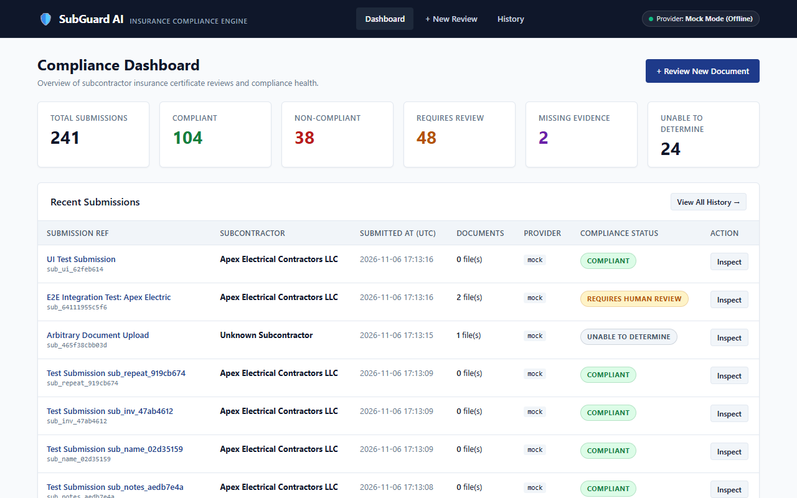
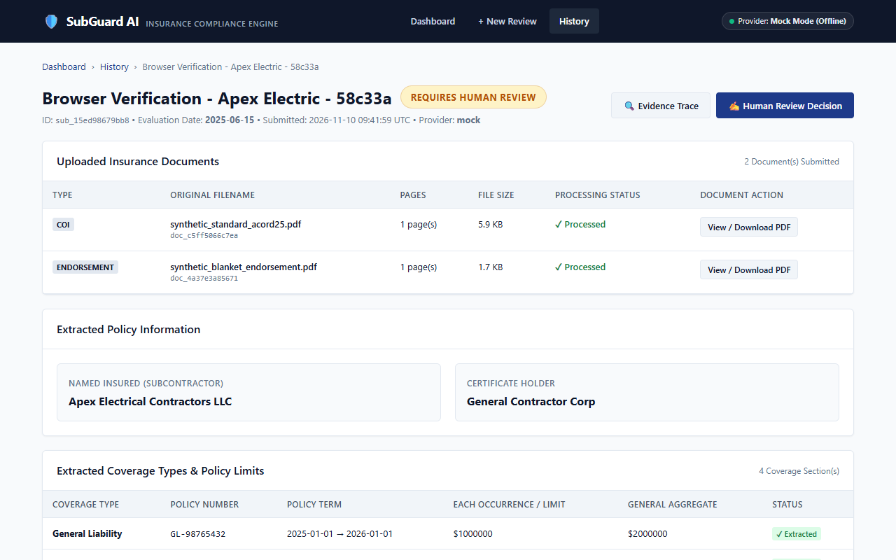
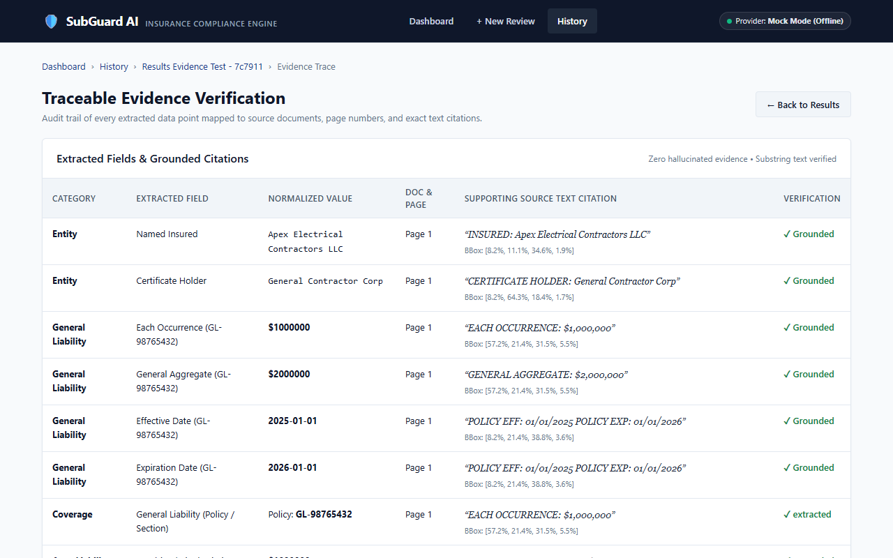
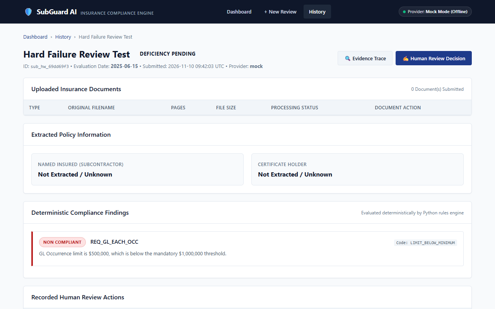
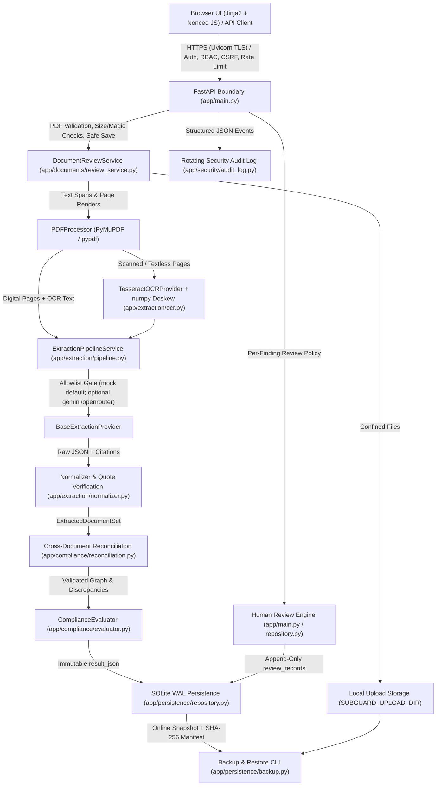

# SubGuard AI

**AI-assisted contractor insurance compliance review and traceable evidence verification.**

SubGuard AI evaluates subcontractor Certificates of Insurance (ACORD 25 COIs) and policy endorsements against contractual insurance requirements. Built around strict separation of concerns, it pairs structured document extraction with deterministic compliance rules and an auditable human-review workflow.

> **Core Engineering Principle:**
> **AI extracts information. Deterministic Python rules evaluate it. Humans resolve uncertainty.**

---

## 1. Project Overview

SubGuard AI is a full-stack Python web application and compliance engine built for reviewing multi-document subcontractor insurance packages. Rather than delegating pass/fail judgment to a generative model, the application constrains extraction to structured schemas with verbatim page citations, normalizes financial limits and dates deterministically, evaluates rules in pure Python, and routes ambiguous or incomplete submissions to qualified human reviewers with an append-only audit trail.

**Project Scope & Current Maturity:** SubGuard AI is currently a **controlled local pilot and engineering portfolio demonstration** operating on synthetic data and deterministic offline (`mock`) extraction by default. It is **not** deployed or cleared for commercial production use, and it does not provide legal advice or replace licensed risk/insurance professionals.

---

## 2. Problem Statement

Reviewing contractor insurance packages manually creates recurring operational and compliance risks:

- **Information is fragmented across documents:** Coverage limits, effective/expiration dates, legal entity names, and special conditions (such as Additional Insured or Waiver of Subrogation) are split across ACORD 25 certificates, blanket/scheduled endorsements (e.g., CG 20 10, CG 24 04), and declaration pages.
- **Manual review misses edge cases:** Subtle corporate entity mismatches (`LLC` vs. `Inc`), expired policy terms, split limits, or COI checkboxes checked without supporting endorsements are easy to overlook under review volume.
- **Pure LLM evaluation is unsafe for compliance:** Unconstrained language models can hallucinate policy coverage, misread numeric thresholds, apply floating-point or informal arithmetic, or produce confident approvals on missing/ambiguous evidence.
- **Compliance decisions require traceability:** Auditors and risk managers need verbatim source quotes, page/coordinate attribution, immutable automated results, and an attributable record of any human review decision.
- **Uncertainty must escalate, not pass silently:** Missing documents, low-confidence OCR, unverified citations, or conflicting policy identifiers between documents should escalate to human reviewers instead of triggering automated approvals or false rejections.

---

## 3. Solution and Core Design Philosophy

SubGuard AI enforces a strict three-stage boundary:

1. **AI Extracts Information (Untrusted Proposal):** PDF text layers, rendered page images, and local OCR feeds are passed to a swappable extraction provider (`mock` default, with optional gated `gemini` and `openrouter` adapters) returning strictly typed raw JSON proposals (`RawInsuranceExtraction`) plus source text quotes.
2. **Deterministic Python Evaluates It (Authoritative Decision):** Pure Python normalizers convert currency into integer cents (`Decimal`), parse dates into `datetime.date`, verify verbatim quote support against actual PDF text layers, reconcile relationships across documents, and evaluate rules in `ComplianceEvaluator` (`backend/app/compliance/evaluator.py`).
3. **Humans Resolve Uncertainty (Auditable Escalation):** Missing evidence, corporate suffix discrepancies, unsupported citations, and cross-document contradictions route to `REQUIRES_HUMAN_REVIEW` or `UNABLE_TO_DETERMINE`. Reviewers record per-finding decisions in an append-only SQLite audit log (`review_records`), while critical deterministic failures (expired policies, inverted dates, confirmed entity mismatches) cannot be silently waived.

---

## 4. Key Features

- **Multi-Document PDF Ingestion & Local OCR:** Validates PDF headers/sizes, extracts embedded text spans and coordinates via PyMuPDF (`fitz`) and `pypdf`, and falls back to local `TesseractOCRProvider` with `numpy`-based page deskew/rotation normalization for scanned/skewed pages.
- **Swappable Extraction Providers with Fail-Closed Allowlist:** Ships with deterministic offline providers (`MockExtractionProvider`, `HonestApplicationMockProvider`) enabled by default via `SUBGUARD_ALLOWED_PROVIDERS=mock`. Optional `gemini` and `openrouter` (`:free`-model-enforced) integrations are rejected (`HTTP 403`) unless explicitly allowlisted.
- **Evidence Grounding & Traceability:** Maps extracted entities, limits, dates, and endorsements to source document IDs, page numbers, verbatim quotes, and bounding boxes, flagging unsupported quotes before evaluation (`QUOTE_PRESENT_UNVERIFIED_SUPPORT`).
- **Deterministic Compliance & Cross-Document Reconciliation:** Evaluates limits in exact integer cents, compares legal entities without conflating distinct corporate forms (`LLC` ≠ `Inc`), and detects contradictory policy numbers or conflicting terms across COIs and endorsements.
- **Per-Finding Human Review & Immutable Audit Trail:** Preserves original automated `result_json` immutably, appends signed review decisions to `review_records`, derives reviewer identity strictly from the authenticated server principal, and blocks waiver of non-waivable critical findings.
- **Security Controls & Online SQLite Backup/Restore:** Role-based access control (`viewer`, `analyst`, `reviewer`, `admin`), `scrypt` password hashing, `HttpOnly`/`Secure`/`SameSite=Lax` cookie sessions, revocable SHA-256 Bearer tokens, CSRF synchronizer tokens, path-confined downloads, structured security logging, and online `sqlite3.Connection.backup()` snapshots.

### Application Screenshots

> *Captured during Milestone 2.2 browser workflow verification on a local synthetic fixture dataset (`Apex Electrical Contractors LLC` / `General Contractor Corp`, offline `mock` provider).*

| Compliance Dashboard | Submission Results & Findings |
| :---: | :---: |
|  |  |

| Traceable Evidence Viewer | Human Review & Audit State |
| :---: | :---: |
|  |  |

---

## 5. System Architecture



---

## 6. Document Processing and Extraction Workflow

1. **Upload Validation (`review_service.py`):** Validates `.pdf` extension, `%PDF-` magic bytes, per-file size (`15 MiB` default), max endorsement count (`10`), cumulative submission payload (`50 MiB`), and bounded processing concurrency (`SUBGUARD_MAX_CONCURRENT_REVIEWS=2`).
2. **PDF Inspection & OCR Fallback (`processor.py`, `ocr.py`):** `PDFProcessor` inspects pages using PyMuPDF and extracts text spans with normalized bounding boxes. Pages lacking usable text layers are rendered and processed via local `TesseractOCRProvider`, including orientation/deskew normalization (`numpy`).
3. **Provider Execution (`providers/`):**
   - **Mock Mode (Default & Verified Pilot Mode):** `MockExtractionProvider` and `HonestApplicationMockProvider` inspect local PDF text/metadata deterministically without network calls or API costs.
   - **Live Providers (Optional, Not Cleared for Production):** `GeminiExtractionProvider` (`google-genai`) and `OpenRouterExtractionProvider` (`openai` client pointed at OpenRouter, strictly limited to `:free`-suffixed models) can be enabled only by adding them to `SUBGUARD_ALLOWED_PROVIDERS` and supplying credentials. Live AI extraction has **not** passed full production validation.
4. **Normalization & Evidence Grounding (`normalizer.py`, `pipeline.py`):** Raw strings convert deterministically to exact integer cents (`normalize_currency_to_cents`), ISO `date` objects (`normalize_date`), and canonical coverage/endorsement enums. Every cited quote is checked against actual page text and semantic value support before being marked `EXTRACTED`; unverified quotes degrade to `QUOTE_PRESENT_UNVERIFIED_SUPPORT` or `UNCERTAIN`.

---

## 7. Deterministic Compliance Evaluation

`ComplianceEvaluator` (`backend/app/compliance/evaluator.py`) evaluates normalized `ExtractedDocumentSet` objects against configured `InsuranceRequirement` rules and an explicit `evaluation_date` with zero LLM calls.

### Projected Compliance Outcomes

The API and review workflow project submissions into four primary compliance outcomes (`ComplianceStatus` in `backend/app/schemas/insurance.py`):

| Outcome | Meaning | Trigger Conditions |
| --- | --- | --- |
| `COMPLIANT` | All required rules verified deterministically | Verified active dates, matching named insured, limits $\ge$ thresholds (in cents), verified required endorsements, no unresolved contradictions |
| `NON_COMPLIANT` | Deterministic hard rule failure | Expired policy, inverted date range, future policy inception, confirmed named insured mismatch, or extracted limit below required minimum on complete upload |
| `REQUIRES_HUMAN_REVIEW` | Explicit ambiguity, contradiction, or review-first escalation | Entity suffix mismatch (`LLC` vs. `Inc`), blanket/conditional endorsement wording, COI checkbox without separate endorsement, unverified citation support, low extraction confidence (`< 0.70`), cross-document contradiction, or `MISSING_EVIDENCE` projected into human review |
| `UNABLE_TO_DETERMINE` | Insufficient verified evidence to evaluate | Incomplete document sets (`is_document_set_complete=False`), missing/corrupted/unreadable required pages, or OCR/extraction failures |

`MISSING_EVIDENCE` exists internally on `ComplianceStatus` to distinguish *missing required policy/endorsement evidence on an evaluated submission* from hard non-compliance; under the Milestone 3.2B review-first policy, `MISSING_EVIDENCE` projects into `REQUIRES_HUMAN_REVIEW` at the submission summary level so missing evidence never auto-rejects or auto-approves.

**Why deterministic rules instead of LLM judgment?** Monetary arithmetic (avoiding floating-point drift via integer cents), strict legal-entity suffix comparison, date-boundary checks, and audit reproducibility require identical outputs for identical inputs. An LLM extracts candidate structured values; deterministic Python rules compute the compliance verdict.

---

## 8. Evidence Verification and Human-Review Workflow

- **Field-Level Grounding:** Every extracted policy limit, date, entity, and endorsement links to `EvidenceReference` records (document ID, page index, verbatim source quote, and bounding box coordinates) inspected in `/submissions/{id}/evidence`.
- **Immutable Original Verdict:** `submissions.result_json` is persisted once upon evaluation and is never overwritten by subsequent human review actions.
- **Append-Only Review Records:** `POST /api/v1/submissions/{id}/review` atomically inserts records into `review_records` (`app/persistence/repository.py`) and computes `overall_status` server-side from full finding replay.
- **Server-Derived Attribution:** Client-supplied `reviewer_name` values cannot impersonate another user; reviewer identity is bound to the authenticated session/token (`current_user.display_name` / `username` and `reviewer_user_id`).
- **Non-Waivable Critical Findings:** `main.py` explicitly forbids waiving critical deterministic failures (`POLICY_EXPIRATION`, `POLICY_EFFECTIVE_DATE`, `NAMED_INSURED`, `POLICY_EXPIRED`, `INVALID_DATE_RANGE_INVERTED`, `POLICY_FUTURE_INCEPTION`, `ENDORSEMENT_EXPIRED`, `ENDORSEMENT_FUTURE_INCEPTION`, `NAMED_INSURED_MISMATCH`, `CONFIRMED_ENTITY_MISMATCH`, `COVERAGE_NOT_FOUND`) and rejects attempts to force `compliant` / `resolved_compliant` while blocking findings remain.

---

## 9. Security and Reliability Controls

Implemented controls verified in source code (`backend/app/security/` and `backend/app/persistence/`) and live local HTTPS testing:

- **Authentication & Password Hardening (`passwords.py`, `service.py`):** Per-user salted `hashlib.scrypt` (`N=131072, r=8, p=1`), dummy verification timing mitigation for unknown usernames, bounded `scrypt` semaphore (`SUBGUARD_MAX_CONCURRENT_SCRYPT=4`), and explicit admin provisioning (`app/security/bootstrap.py`; no default passwords).
- **Session & API Token Security (`service.py`, `rbac.py`):** Opaque tokens stored hashed (`SHA-256`) in SQLite `sessions` with absolute TTL (`8h` default) and idle timeout (`1h` default). Browser sessions use `HttpOnly`, `SameSite=Lax`, and `Secure` cookies (required in `production`). API clients can use revocable Bearer tokens.
- **4-Tier RBAC (`rbac.py`):** `viewer` (read/download), `analyst` (+ upload/evaluate), `reviewer` (+ human review decisions), and `admin` (+ user/token provisioning & system health).
- **CSRF & Response Hardening (`rbac.py`, `main.py`):** Synchronizer CSRF validation (`X-CSRF-Token` / form field + pre-login double-submit HMAC cookie) on all cookie-authenticated mutations; CSP with per-request script nonces, `X-Frame-Options: DENY`, `X-Content-Type-Options: nosniff`, `Referrer-Policy: no-referrer`, `Cache-Control: no-store`, and HSTS over HTTPS. Production mode disables `/docs`, `/redoc`, and `/openapi.json` (`404`).
- **Rate Limiting & Concurrency Gates (`rate_limit.py`, `review_service.py`):** In-memory sliding-window throttling for login attempts (`5/user`, `25/IP` per `60s` default) and authenticated mutations (`120/user` per `60s`), plus bounded document processing concurrency.
- **Upload & Download Confinement (`review_service.py`, `main.py`):** Validates PDF magic bytes and size limits; downloads verify `(document_id, submission_id)` association in SQLite and resolve paths strictly inside `SUBGUARD_UPLOAD_DIR/<submission_id>/` while rejecting symlinks and traversal segments.
- **Structured Audit Logging (`audit_log.py`):** Optional `RotatingFileHandler` JSON logging for auth, CSRF failures, policy rejections, token changes, and human reviews without logging passwords, tokens, or PDF contents.
- **Online SQLite Backup & Recovery (`backup.py`):** Uses `sqlite3.Connection.backup()` (safe with WAL mode), generates SHA-256 upload manifests, verifies integrity/foreign keys/path confinement, and refuses to overwrite non-empty target directories during `restore`.

**Deployment Constraints:** Rate limiters and concurrency semaphores are process-local (`--workers 1` required). Persistence uses single-node local SQLite (`WAL` mode). Multi-tenant per-organization isolation, SSO/MFA, and self-service password reset are not implemented.

---

## 10. Technology Stack

Verified directly against `backend/pyproject.toml` and application imports:

| Layer | Core Dependencies (`pyproject.toml`) | Optional / System Tools |
| --- | --- | --- |
| **Web & API** | Python `>=3.12`, FastAPI `>=0.115.0`, Uvicorn `>=0.30.6`, Jinja2 `>=3.1.0`, `python-multipart` `>=0.0.12` | Vanilla HTML/CSS/JavaScript (CSP nonced) |
| **Data & Validation** | Pydantic `>=2.9.2`, SQLite (`sqlite3` stdlib, WAL mode) | — |
| **PDF & OCR** | PyMuPDF (`pymupdf>=2.0.0`), `pypdf>=6.20.0`, NumPy (`numpy>=2.0.0`, used for OCR image deskew/orientation in `app/extraction/ocr.py`) | Local **Tesseract OCR** CLI binary (`tesseract`) |
| **AI Extraction** | Built-in offline `mock` providers (no network dependencies) | `[providers]` extra: `openai>=1.50.0` (OpenRouter), `google-genai>=1.0.0` (Gemini) |
| **Testing** | `unittest` (stdlib) | `[dev]` extra: `pytest>=8.0.0`, `httpx>=0.27.0`, `playwright>=1.40.0` |

---

## 11. Repository Structure

```text
SubGuard-AI/
├── README.md                         # Project overview, setup, verified results, and limits
├── PRODUCT_SPEC.md                   # Original product specification
├── ARCHITECTURE.md                   # System architecture notes
├── AI_EXTRACTION_DESIGN.md           # Extraction pipeline design documentation
├── DATABASE_SCHEMA.md                # SQLite schema documentation
├── SECURITY.md                       # Security model and threat-model notes
├── docs/
│   ├── PORTFOLIO_CASE_STUDY.md       # Engineering case study for portfolio presentation
│   └── phase-7-1-benchmark-plan.md   # Cohort benchmark plan
├── evaluation/
│   └── reports/browser_screenshots/  # Verified Milestone 2.2 browser UI screenshots
└── backend/
    ├── pyproject.toml                # Package metadata and verified dependencies
    ├── requirements.lock             # Locked dependency versions
    ├── .env.example                  # Placeholder environment template (no secrets)
    ├── README.md                     # Backend benchmark and operations reference
    ├── app/
    │   ├── main.py                   # FastAPI routes, TLS/security headers, UI/API endpoints
    │   ├── compliance/
    │   │   ├── evaluator.py          # Deterministic rule evaluation & entity suffix checks
    │   │   └── reconciliation.py     # Cross-document relationship & discrepancy checks
    │   ├── documents/
    │   │   ├── processor.py          # PyMuPDF/pypdf inspection & bounding-box extraction
    │   │   └── review_service.py     # Upload validation, storage confinement & orchestration
    │   ├── extraction/
    │   │   ├── normalizer.py         # Integer-cents currency & ISO date normalization
    │   │   ├── ocr.py                # BaseOCRProvider, TesseractOCRProvider & MockOCRProvider
    │   │   ├── pipeline.py           # Quote grounding & ExtractedDocumentSet assembly
    │   │   └── providers/            # base.py, mock.py, gemini.py, openrouter.py
    │   ├── persistence/
    │   │   ├── database.py           # SQLite WAL connection & schema migrations (v2)
    │   │   ├── repository.py         # Atomic persistence & append-only review queries
    │   │   └── backup.py             # Online SQLite backup, integrity check & restore CLI
    │   ├── schemas/                  # Pydantic v2 domain, PDF, raw extraction & reconciliation models
    │   ├── security/                 # bootstrap, config, passwords, rate_limit, rbac, service, audit_log
    │   ├── static/                   # CSS assets
    │   └── templates/                # Jinja2 HTML templates (dashboard, evidence, review, admin, login)
    ├── evaluation/                   # Frozen Cohort v1 (40 scenarios, 66 PDFs), metrics & CLI runners
    └── tests/                        # Unit, integration, security, reliability & browser tests
```

---

## 12. Installation and Local Setup

**Prerequisites:**
- Python `3.12+`
- Local **Tesseract OCR** installed (`tesseract` on `PATH`, or configured via `TESSERACT_CMD`)

```powershell
cd backend
python -m venv .venv
.\.venv\Scripts\Activate.ps1

# Core runtime dependencies
pip install -e . -c requirements.lock

# Optional: test tools (pytest, httpx, playwright)
pip install -e ".[dev]" -c requirements.lock

# Optional: external AI provider SDKs (openai, google-genai)
pip install -e ".[providers]" -c requirements.lock
```

---

## 13. Configuration and Environment Variables

Copy `backend/.env.example` to `backend/.env` (never commit real secrets). Key variables verified in `backend/app/security/config.py`:

| Variable | Default / Example | Purpose |
| --- | --- | --- |
| `SUBGUARD_ENV` | `development` (`production` for pilot) | Enables strict fail-closed checks, disables `/docs` & `/openapi.json` |
| `SUBGUARD_SESSION_SECRET` | Mandatory `>=32` random chars in `production` | HMAC/session signing key (`python -c "import secrets; print(secrets.token_urlsafe(48))"`) |
| `SUBGUARD_ALLOWED_PROVIDERS` | `mock` | Server-enforced allowlist (`mock`, `gemini`, `openrouter`) |
| `EXTRACTION_PROVIDER` | `mock` | Active extraction provider (`mock` default) |
| `SUBGUARD_ENABLE_DEMO_ENDPOINT` | `true` in dev; **`false` in production** | Controls `/api/v1/compliance/demo-run/{scenario_id}` |
| `SUBGUARD_COOKIE_SECURE` | Auto (`true` in production) | Forces `Secure` flag on session and CSRF cookies |
| `SUBGUARD_ENFORCE_HTTPS` | `false` in dev (`true` in production) | Rejects plaintext HTTP unless terminated by trusted TLS/proxy |
| `SUBGUARD_TRUSTED_PROXIES` | Empty | Comma-separated trusted proxy IPs; leave empty when running Uvicorn TLS directly |
| `SUBGUARD_DB_PATH` | `./data/subguard.db` | SQLite database file path |
| `SUBGUARD_UPLOAD_DIR` | `./data/uploads` | Confined directory for uploaded PDFs |
| `SUBGUARD_AUDIT_LOG_PATH` | Empty (optional) | Path for rotating JSON security audit log |
| `TESSERACT_CMD` | Auto-detected | Explicit path to `tesseract` binary if not on `PATH` |

---

## 14. Running the Application

### 1. Provision an Initial Administrator Account
No default credentials exist in the codebase:

```bash
cd backend
python -m app.security.bootstrap create-admin --username pilot_admin --display-name "Pilot Admin"
```

### 2. Local Development Mode
```bash
cd backend
python -m uvicorn app.main:app --host 127.0.0.1 --port 8000
```

### 3. Controlled Single-Worker Direct HTTPS Mode (Production Settings)
For local HTTPS without a reverse proxy, run a single Uvicorn worker bound strictly to loopback (`--no-proxy-headers`, TLS cert/key files outside the repo, `SUBGUARD_ENV=production`, `SUBGUARD_TRUSTED_PROXIES=` empty):

```bash
cd backend
python -m uvicorn app.main:app --host 127.0.0.1 --port 8443 --workers 1 --no-proxy-headers --ssl-certfile /path/to/localhost.crt --ssl-keyfile /path/to/localhost.key
```

### 4. Online Backup, Verification, and Safe Restore
```bash
cd backend
python -m app.persistence.backup backup --output-dir /path/to/backups
python -m app.persistence.backup verify --manifest /path/to/backups/<backup_name>/manifest.json
python -m app.persistence.backup restore --backup-dir /path/to/backups/<backup_name> --target-db-path /path/to/new_target/subguard.db --target-upload-dir /path/to/new_target/uploads
```

---

## 15. Running Tests

Run the unit, security, reliability, and integration suites (excluding Playwright browser acceptance when targeting headless CI):

```bash
cd backend
pytest tests --ignore=tests/test_browser_workflow_acceptance.py -q
```

Run the frozen 40-scenario cohort benchmark offline (`mock` provider):

```bash
cd backend
python -m evaluation.runners.scenario_runner
```

Run single-document extraction benchmarking:

```bash
cd backend
python -m evaluation.runners.benchmark --provider mock --format both
```

---

## 16. Evaluation Methodology and Actual Results

### Frozen Synthetic Cohort v1 (`cohort_v1.0.0`)

Verified against `backend/evaluation/cohorts/manifests/cohort_v1_manifest.json` and `backend/evaluation/reports/wp5_cohort_run/post_fix_cohort_v1_mock.md`:

- **Dataset Size:** **40** synthetic scenarios across **66** multi-document PDFs covering compliant sets (`SCEN-01`–`10`), definitive failures (`SCEN-11`–`20`), ambiguity/human review (`SCEN-21`–`28`), incomplete sets (`SCEN-29`–`33`), cross-document contradictions (`SCEN-34`–`37`), and adversarial evidence grounding (`SCEN-38`–`40`).
- **Offline Mock Baseline Results (`post_fix_cohort_v1_mock`):**
  - **Processing Success:** `40/40` scenarios (`0` failures)
  - **False Compliance Rate (FCR):** `0.00%` (`0/10`)
  - **Unsafe Compliance Rate (UCR):** `0.00%` (`0/30` — zero unsafe ground-truth scenarios passed as `COMPLIANT`)
  - **Overall Submission Status Accuracy (4-class projection):** `50.00%` (`20/40`)
  - **Macro F1 Score:** `0.4521` (Weighted F1: `0.4502`)
  - **Outcome Routing Distribution:** `70.00%` (`28/40`) `REQUIRES_HUMAN_REVIEW`, `17.50%` (`7/40`) `NON_COMPLIANT` reject, `12.50%` (`5/40`) `UNABLE_TO_DETERMINE`, `0.00%` (`0/40`) automated `COMPLIANT` pass.

**Important Benchmark Interpretation & Limitations:**
- These figures come from **offline `mock` extraction on synthetic scenarios**, not real-world production contractor packets or a live vision-language model.
- `40/40` processing success measures pipeline execution completion, whereas `50.00%` classification accuracy reflects exact 4-class status match (notably, the mock baseline conservatively routed all `10` ground-truth `COMPLIANT` scenarios to `REQUIRES_HUMAN_REVIEW` under review-first missing-evidence rules).
- `0.00%` false-compliant / uncertainty-leakage rates apply strictly to this frozen cohort definition and provider setup—they do **not** guarantee zero errors on unseen real-world documents.

### Phase 7A Live Direct-HTTPS Acceptance (`https://127.0.0.1:8443`)

Executed against a live single-worker Uvicorn TLS instance in `production` + `mock` mode using an isolated disposable copy of the recovery-drill dataset and strict CA verification (`CERT_REQUIRED`, `check_hostname=True`):

- **Live HTTPS Acceptance Checks:** **17 passed, 0 failed, 0 skipped** covering TLSv1.3 handshake and peer SHA-256 verification, hostname mismatch & plaintext HTTP rejection, disabled `/docs`/`/redoc`/`/openapi.json`/`demo-run` and rejected `gemini`/`openrouter` providers (`403`), auth/session cookie flags (`Secure`, `HttpOnly`, `SameSite=Lax`), CSRF enforcement, logout/expired/revoked token rejection, 4-role RBAC enforcement, synthetic upload/mock extraction/evaluation/evidence display, invalid/oversized upload rejection, non-waivable review enforcement & append-only audit immutability, submission-bound downloads & traversal rejection, `/health`, `/api/v1/admin/system-health`, and log hygiene.
- **Browser Automation over HTTPS:** **NOT RUN** (`tests/test_browser_workflow_acceptance.py` spawns its own internal HTTP server and relies on browser/Windows CA trust; Windows CA trust store was intentionally left unmodified during headless validation).

---

## 17. Known Limitations

- **Controlled Local Pilot Only:** Tested as a loopback-only single-workstation demonstration (`127.0.0.1:8443`); **not** cleared for commercial production or public internet exposure.
- **Mock Extraction Is the Verified Pilot Mode:** `SUBGUARD_ALLOWED_PROVIDERS=mock` is the verified pilot baseline; optional live `gemini` and `openrouter` adapters have not undergone full production validation.
- **Synthetic Accuracy Limits:** Cohort v1 results (`40` scenarios / `66` PDFs) demonstrate deterministic pipeline behavior on synthetic fixtures and do not establish real-world LLM extraction accuracy.
- **Browser HTTPS Automation Untested:** Automated Playwright browser acceptance has not been executed over live HTTPS (`https://127.0.0.1:8443`).
- **Windows Host & AV Constraints:** Pilot HTTPS validation occurred on Windows 11 where Smart App Control blocked unsigned reverse-proxy execution (`caddy.exe`) and local loopback TLS required a narrow antivirus URL exception plus manual CA trust onboarding for browser UI access.
- **Single-Worker & SQLite Boundaries:** In-memory rate limiters and concurrency semaphores require `--workers 1`; single-node SQLite (`WAL` mode) does not support multi-node horizontal scaling.
- **Single-Tenant Scope:** Authenticated users share instance visibility scoped by role (`viewer`–`admin`); multi-tenant organization isolation, MFA, and self-service password recovery are out of scope.

---

## 18. Future Development Scope

- **Live Multimodal Evaluation on Real-World Redacted COIs:** Benchmark open-weights/commercial VLMs against a curated, de-identified real ACORD 25 + endorsement dataset while preserving the deterministic rule engine.
- **Enterprise PKI & Clean Server Deployment:** Run behind a signed reverse proxy (nginx/Caddy/IIS ARR) on a dedicated server/VM without consumer antivirus TLS interception.
- **Multi-Tenant & Operational Scaling:** Add organization-scoped row-level isolation, PostgreSQL persistence, Redis-backed distributed rate limiting, SSO/MFA, and automated encrypted offsite backups.
- **Expanded Insurance Rule Packs:** Support custom contract templates, trade-specific limit schedules, and automated renewal-window monitoring.

---

## 19. Author and Project Information

- **Author:** Muhammad Hammad Azam ([hammadazam.me](https://hammadazam.me))
- **Repository:** [github.com/MHammadAzam/SubGuard-AI](https://github.com/MHammadAzam/SubGuard-AI)
- **Engineering Case Study:** [docs/PORTFOLIO_CASE_STUDY.md](docs/PORTFOLIO_CASE_STUDY.md)

*Disclaimer: SubGuard AI is an engineering prototype and controlled local pilot for compliance document review automation. It does not provide legal advice or replace licensed insurance brokers, underwriters, or risk managers.*
